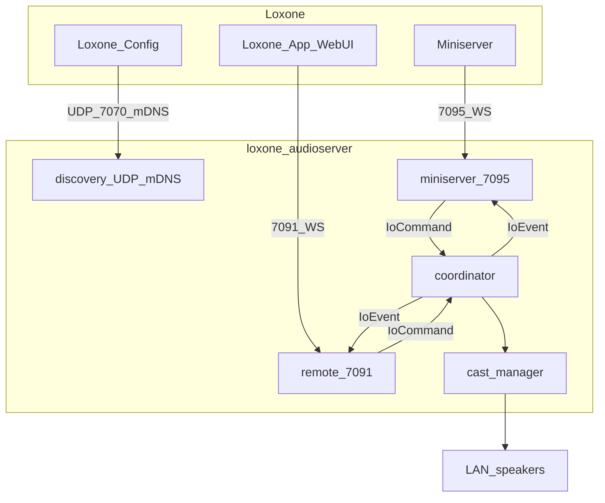
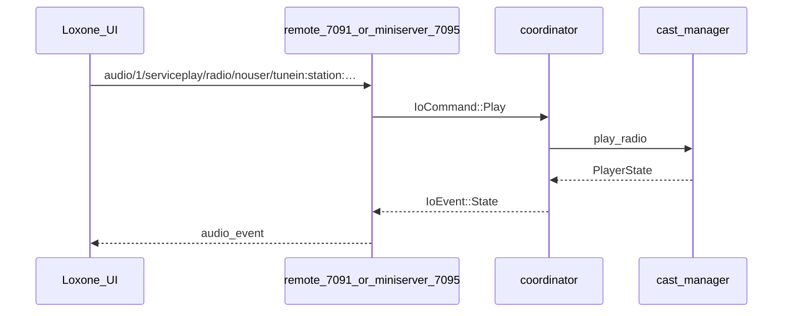

# Audioserver architecture

High-level overview of **loxone-audioserver**: what it does, which components it talks to, and how the internal pieces fit together. For wire formats and field tables, follow the links in [Related documentation](#related-documentation).

## Purpose and scope

This repository implements a software **Loxone Audioserver**. It speaks the Loxone Audioserver protocol to Loxone Config, the Miniserver and the Loxone App, and maps each Loxone audio zone to a playback backend on the LAN:

- **Google Cast** — TuneIn and custom radio started from the Loxone App ([radio-cast.md](radio-cast.md)).
- **Speaker control backends** — local APIs of KEF and Naim speakers for play/pause, volume, power and now-playing. Content is chosen in each speaker's own app. Implemented for the KEF W2 platform and Naim Mu-so 2nd gen ([`speaker/stream800.rs`](../src/speaker/stream800.rs)); first-generation KEF is not yet.

The Qobuz Connect controller that earlier versions used was removed in November 2026 after its upstream crates disappeared; it remains in git history.

The binary runs as a single **daemon** (`loxone-audioserver --serial … --name …`): LAN discovery, Miniserver pairing (7095), Web UI (7091) and the coordinator.

## Zones and players

| Term | Where it appears | Meaning |
|------|------------------|---------|
| **Audio zone** | Loxone App structure (`AUDIO_ZONE_V2`), `AudioZoneControl` | A room/music tile in the smart-home UI |
| **Player** | Audioserver wire protocol (`audio/{playerid}/…`), `setconfig` → `players[]`, `PlayerState.playerid` | The audioserver's identifier for that output |

One audio zone maps 1:1 to one `playerid`. Internal names such as [`ZoneDescriptor`](../src/loxone_config.rs) and [`zone_transport`](../src/zone_transport.rs) mean "the player entry for that Loxone audio zone".

## Loxone ecosystem

- **Loxone Config** discovers Audioservers on the LAN (UDP **7070** / mDNS `_loxaudio._tcp`) so the installer can add the device. It keeps no runtime connection.
- **Loxone Miniserver** connects on WebSocket **7095** for pairing, config sync (`setconfig`, `playername`, `volumes`, `ready`, …) and some transport commands. See [miniserver-protocol.md](miniserver-protocol.md#initial-onboarding-loxone-config-add).
- **Loxone App / Web UI** connects primarily on **7091**; some transport also arrives on **7095** depending on the client build. See [traffic-paths.md](traffic-paths.md).

## Runtime topology

[`run_serve_daemon`](../src/main.rs) starts [`discovery::start_discovery`](../src/discovery/) (UDP/mDNS for Loxone Config), spawns speaker discovery ([`speaker::manager::spawn_discovery`](../src/speaker/manager.rs), every 60 s) and three `tokio` tasks: `remote` (7091), `miniserver` (7095) and `coordinator`. They are wired through:

- `mpsc::Sender<IoCommand>` — inbound commands from both WebSocket adapters to the coordinator
- `broadcast::Sender<IoEvent>` — outbound events (`audio_event`, config, room favorites) to both adapters
- `mpsc::Sender<SpeakerEvent>` — speaker discovery results and per-zone speaker status into the coordinator

## Internal components

| Component | Source | Responsibility |
|-----------|--------|----------------|
| Entry | [`main.rs`](../src/main.rs) | CLI flags, task spawn, shutdown |
| Miniserver adapter | [`miniserver/`](../src/miniserver/) | 7095 WebSocket, secure pairing, config sync; shared transport/`getqueue` fallback |
| Remote adapter | [`remote/`](../src/remote/) | 7091 WebSocket, bootstrap, radio browse/search, room favorites, EQ |
| Coordinator | [`coordinator/`](../src/coordinator/) | `IoCommand` loop, config sync, radio browse, transport dispatch |
| Zone registry | [`zone_registry.rs`](../src/zone_registry.rs) | Authoritative per-zone state, ownership invariants, dedup |
| Zone publish | [`zone_publish.rs`](../src/zone_publish.rs) | Registry commit and `IoEvent::State` fan-out |
| Zone enrich | [`zone_enrich.rs`](../src/zone_enrich.rs) | Cover proxy, Loxone envelope |
| Connect bootstrap | [`connect_bootstrap.rs`](../src/connect_bootstrap.rs) | Snapshots for newly connected clients and lag resync |
| Zone transport | [`zone_transport.rs`](../src/zone_transport.rs) | Route parsing for play/pause/volume/seek on 7091 and 7095 |
| Cast | [`cast/`](../src/cast/) | Cast discovery, radio session, remote volume/transport mirroring |
| Radio | [`radio/`](../src/radio/) | TuneIn API, custom streams, radio audiopaths |
| Speaker control | [`speaker/`](../src/speaker/) | `SpeakerBackend` trait, mDNS discovery, zone binding, polling manager, status → `PlayerState` mapper |
| Persisted config | [`config/`](../src/config/) | `audioserver-config.json`, wire CRC, zone mapping sync |
| Player state | [`player_state.rs`](../src/player_state.rs) | Loxone wire shape for now-playing / idle |
| Wire response | [`wire_response.rs`](../src/wire_response.rs) | Consistent `*_result` JSON envelope |

## PlayerState pipeline

| Question | Owner |
|----------|-------|
| Zone ownership, invariants, dedup | [`ZoneRegistry`](../src/zone_registry.rs) |
| Live Cast session | [`cast/manager.rs`](../src/cast/manager.rs) |
| Speaker polls and commands | [`speaker/manager.rs`](../src/speaker/manager.rs), [`coordinator/speaker.rs`](../src/coordinator/speaker.rs) |
| Cover proxy, EQ overlay, Loxone envelope | [`zone_enrich.rs`](../src/zone_enrich.rs) |
| Commit and `audio_event` fan-out | [`zone_publish.rs`](../src/zone_publish.rs) |
| Async orchestration | [`coordinator/`](../src/coordinator/) |

Only the coordinator task writes the registry, and producers publish only through `zone_publish`. [`PlaybackSource`](../src/zone_registry.rs) records who owns a zone: `Idle`, `CastRadio` (an audioserver-started radio session) or `External` (playback reported by the zone's speaker). Speaker polls arrive as `ZoneUpdate::SetPlayerState`; while a zone is `CastRadio` they are ignored, so a radio session started from Loxone wins until it ends.

### Speaker binding

1. Speaker discovery browses `_sues800device._tcp` (KEF / Naim on StreamUnlimited) and `_airplay._tcp` (first-gen KEF, confirmed via TCP 50001) every 60 s. The coordinator **remembers** every speaker seen ([`discovery::remember`](../src/speaker/discovery.rs)): a speaker missing from one browse stays bound, and a failed browse changes nothing. A speaker that is really gone is reported by its zone's poll loop as unreachable.
2. [`speaker/binding.rs`](../src/speaker/binding.rs) auto-binds zones whose Loxone name equals a speaker name (persisting `speaker_id`), then resolves each zone's `speaker_id` / `speaker_host` / `speaker_kind` to an address and API. Rows that can never bind as written (manual host without a valid kind) are logged as `speaker binding misconfigured`.
3. [`SpeakerManager`](../src/speaker/manager.rs) runs one task per bound zone. It polls the speaker (1 s while playing, 5 s otherwise, 300 ms for 4 s after a command), reports changes, and executes queued transport commands **in order**, so the coordinator only enqueues and a slow speaker never blocks other zones. After a power-on it waits until the speaker reports on before the next command (e.g. Play). Three failed polls mark the zone unreachable.
4. While a Cast radio session owns a zone, speaker statuses (including volume) are skipped. When the session ends, the coordinator calls `SpeakerManager::refresh`, which re-publishes the speaker's current status.
5. Binding re-runs when the known speaker list changes, and on `setconfig` and `playername`.

[`refresh_zone_from_backends`](../src/coordinator/status.rs) is the explicit cold-start exception for `Status`: when a zone slot is empty it polls the Cast manager before seeding the registry.

### Radio play flow

## Persistence

| File | Purpose |
|------|---------|
| `audioserver-config.json` | Loxone `setconfig` snapshot and CRC; `players[]` with zone mappings, volume presets, room favorites |
| `recents/{playerid}.json` | Per-zone recents for the Loxone UI |
| `custom-radios.json`, `custom-radio-covers/` | Custom radio stations |
| `private.pem` | Secure pairing key for 7095 (via [`app_config`](../src/app_config.rs)) |

**Authentication model:** **7095** Miniserver pairing uses JWT/RSA in [`secure_session.rs`](../src/miniserver/secure_session.rs); **7091** `secure/authenticate` is an intentional bootstrap stub in [`handlers/secure.rs`](../src/remote/handlers/secure.rs).

## Observability

Set `LOXONE_AUDIT=1` to append `port<TAB>command` lines to `command-audit.log`. Capture procedure: [traffic-paths.md § Capture procedure](traffic-paths.md#capture-procedure).

## Out of scope / known gaps

- Streaming-service browse in the Loxone UI — `getservices` is empty; music is started from speaker apps
- Queue panel — `getqueue` answers an empty queue
- NAS / local library / LMS playlists — not implemented ([web-ui-protocol.md](web-ui-protocol.md))
- TLS on 7095 — not implemented

## Related documentation

| Document | Contents |
|----------|----------|
| [README.md](../README.md) | Build, onboarding, configuration |
| [miniserver-protocol.md](miniserver-protocol.md) | 7095 pairing, config sync, secure session, `audio_event` |
| [web-ui-protocol.md](web-ui-protocol.md) | 7091 bootstrap, browse, transport |
| [traffic-paths.md](traffic-paths.md) | Which commands use 7091 vs 7095; audit capture |
| [radio-cast.md](radio-cast.md) | TuneIn / custom radio over Google Cast |
| [ui-wire-commands.md](ui-wire-commands.md) | Exhaustive wire command inventory |
