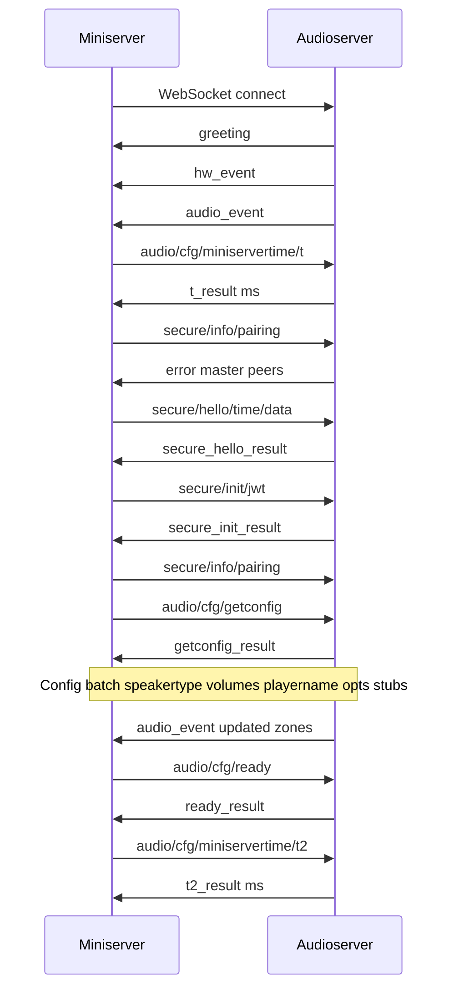
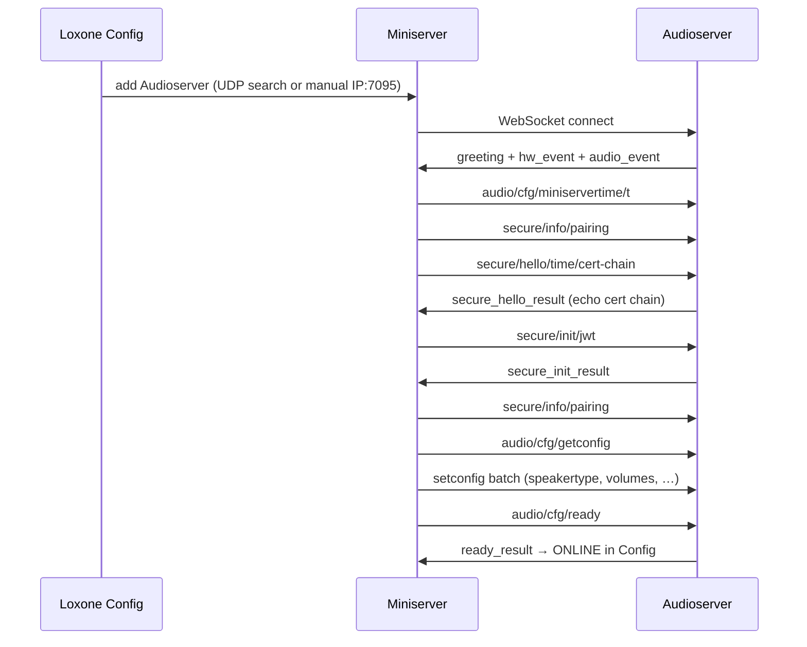
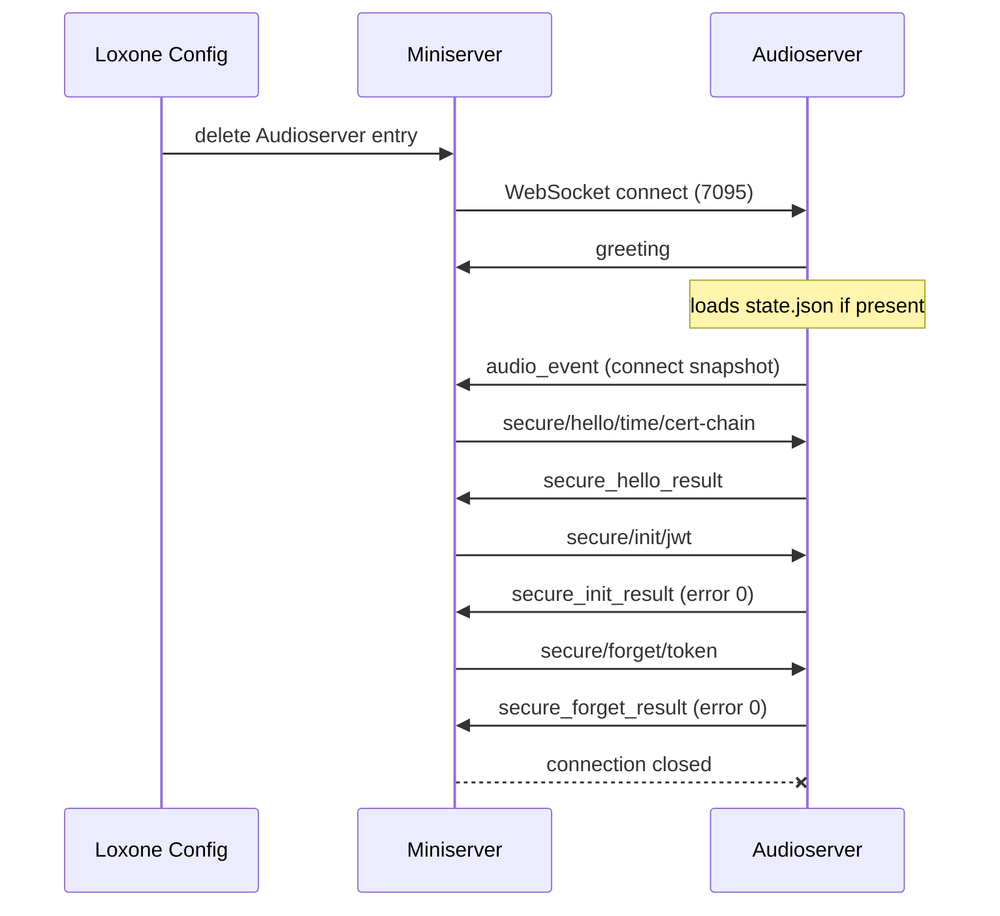

# Miniserver ↔ Audioserver protocol (port 7095)

Reference for WebSocket traffic between the **Loxone Miniserver** (pairing / config) and this Audioserver implementation. Ground truth: [`trace-7095.txt`](../reference/loxone-ui/trace-7095.txt), [`src/miniserver/mod.rs`](../src/miniserver/mod.rs), and [lox-audioserver `dev`](https://github.com/lox-audioserver/lox-audioserver/tree/dev).

## Document conventions

Each **command** section uses the same layout:

| Block | Content |
|-------|---------|
| **Path** | Wire command line (client → server) |
| **Direction** | Who initiates |
| **Purpose** | Why the Miniserver sends it |
| **Request** | Path parameters and body encoding |
| **Response** | JSON shape (`*_result` or push envelope) |
| **Fields** | Table: field, type, meaning (or *unknown*) |
| **Side effects** | `IoCommand` / broadcasts in this repo |
| **Current** | [`src/miniserver/mod.rs`](../src/miniserver/mod.rs) |
| **Reference** | lox-audioserver handler module |

**Trace caveat:** Wireshark exports may glue multiple commands or JSON objects on one line (e.g. [`trace-7095.txt`](../reference/loxone-ui/trace-7095.txt) line 37). Sequence diagrams below use **logical** one-frame-per-step order.

---

## Transport and framing

| Item | Value |
|------|--------|
| Port | **7095** TCP (`0.0.0.0:7095` in `miniserver::start`) |
| Subprotocol | WebSocket; server accepts `Sec-WebSocket-Protocol: miniserver` |
| TLS | Optional HTTP/TLS on same port via dual-stack listener (see [`src/tls.rs`](../src/tls.rs)); pairing trace is plain WS |

### Message types

1. **Greeting** (server → client, first frame): plain text, not JSON.
2. **Command** (client → server): single line, e.g. `audio/cfg/getconfig`.
3. **Response** (server → client): JSON object with echoed `command` and a `*_result` payload (or dynamic `{time}_result` for miniservertime).
4. **Push** (server → client, unsolicited): JSON only — `{"hw_event":[...]}` or `{"audio_event":[...]}` — no prior command.

### Greeting format (7095)

```
MINISERVER V LWSS V {version} {serial} | ~API:{api_version}~ | Session-Token: {token}
```

Example from trace:

```
MINISERVER V LWSS V 17.1.05.05 8E09F7D5ADDB | ~API:1.6~ | Session-Token: 8WahwAfU...
```

Implemented in `handle_socket`; session token comes from [`AppConfig::remote_session_token`](../src/app_config.rs) (default [`DEFAULT_REMOTE_SESSION_TOKEN`](../src/app_config.rs) — same constant as [lox-audioserver `DEFAULT_SESSION`](https://github.com/lox-audioserver/lox-audioserver/blob/dev/src/config/loxone.ts)). The Miniserver later sends this value back inside the `secure/init` JWT as `session_token`.

### Client roles and dual paths

| Client | Typical port | Notes |
|--------|--------------|-------|
| Loxone Config | **7095** | Pairing, `setconfig`, `ready`, `secure/*` |
| Miniserver upstream | **7095** | Same socket; `hw_event` + config |
| Loxone App / Web UI | **7091** and/or **7095** | Same session often uses **both** ports; see observed routing below |

This daemon listens on **both** ports when `serve` runs. Zone transport is shared ([`zone_transport.rs`](../src/zone_transport.rs)).

### Observed routing (7095 focus)

From `command-audit.log` (119 commands, Loxone mobile + desktop, `LOXONE_AUDIT=1`). Full matrix: [traffic-paths.md](traffic-paths.md). Re-capture after firmware upgrades.

| On **7095** (this port) | Examples |
|-------------------------|----------|
| Pairing / TLS | `secure/info/pairing`, `secure/hello`, `secure/init`, **`secure/forget`** |
| Zone config | `getconfig`, `volumes`, `playername`, `playeropts`, `ready`, `miniservertime` |
| Play / pause / queue skip | `audio/1/play`, `pause`, `queueplus`, `queueminus` |
| Absolute volume | `audio/1/volume/{n}` (+ `audio/cfg/volumes` sync) |
| TTS | `audio/grouped/tts/...` (handler not implemented yet) |
| Pushes | `hw_event`, `audio_event` |

| Not seen on 7095 in this capture | Typical port |
|----------------------------------|--------------|
| Bootstrap (`getkey`, `authenticate`, `getservices`) | **7091** — `authenticate` is a UI handshake stub only; do not treat as authorization (real pairing is 7095 `secure/hello` + `secure/init`) |
| Browse (`getservicefolder`, `globalsearch`, `recent`) | **7091** |
| Vol +/−, repeat, seek, `getqueue` | **7091** (primary in audit) |
| `status` | *not exercised* |

**Server note:** `getqueue` is **not rejected on 7095** — when the miniserver config router does not match, [`try_dispatch_getqueue`](../src/remote/mod.rs) handles the same wire paths as port 7091 (**7091 primary** in audit; **7095 fallback** implemented). See [traffic-paths.md](traffic-paths.md).

**Takeaway:** Treat **7095 as mandatory for play/pause/skip** in this setup even when the music UI is open on 7091. [`trace-7095.txt`](../reference/loxone-ui/trace-7095.txt) is pairing-only and does not show UI transport.

### Result naming

lox-audioserver uses the last path segment as the result name ([`responses.ts`](https://github.com/lox-audioserver/lox-audioserver/blob/dev/src/adapters/loxone/commands/responses.ts)):

```json
{ "<name>_result": <payload>, "command": "<echo>" }
```

Exception: `audio/cfg/miniservertime/{time}` → **`"{time}_result"`** (numeric epoch ms), not `miniservertime_result`.

### Base64 JSON bodies

Many `audio/cfg/*/{data}` paths embed **standard base64** (no padding) JSON. Types are defined in [`src/loxone_config.rs`](../src/loxone_config.rs) (`Volumes`, `PlayerNames`, `PlayerOpts`, `SpeakerTypes`, `GroupOpts`, full `SerialWithConfig` for `setconfig`).

---

## Pairing sequence (reference trace)

Logical order from [`trace-7095.txt`](../reference/loxone-ui/trace-7095.txt):



---

## Initial onboarding (Loxone Config add)

When a **new** Audioserver is added in Loxone Config (no [`state.json`](../state.json) yet), the Miniserver connects to **7095** and retries until pairing succeeds or Config marks the device offline. Captured in [`initial-onboard.log`](../initial-onboard.log) (2026-05-24).

**Expected successful path** (matches [`trace-7095.txt`](../reference/loxone-ui/trace-7095.txt)):



**Retry pattern when hello stalls:** Miniserver sends `secure/hello` **~4–5 times** (~1 s apart), calls `secure/info/pairing` again, then drops the socket. Config reconnects with **increasing backoff** (~16 s → ~36 s). After ~7 attempts it stops and shows the Audioserver as **offline**.

| Symptom in log | Likely cause |
|----------------|--------------|
| **`secure/init` never appears** after multiple `secure/hello` | `public_key` is audioserver SPKI instead of echoed Miniserver cert chain — Miniserver never proceeds to init. |
| `Failed to load config file state.json` | Normal on first add; in-memory default config is used until `setconfig`. |
| `secure/info/pairing` → `master: ""` | Normal before first `setconfig` (no Miniserver master serial stored yet). |
| `session_keys decrypt failed` after init | Expected with self-generated `private.pem`; see [Secure pairing — research findings](#secure-pairing--research-findings). **Non-fatal** — Config still goes online. |

The Miniserver expects the default **cert-chain echo** in `secure_hello_result.public_key` before it sends `secure/init`. Returning audioserver SPKI instead of the echo breaks onboarding (see research section).

**Port note:** Miniserver onboarding uses **7095 only** ([`trace-7095.txt`](../reference/loxone-ui/trace-7095.txt)). `audio/cfg/getkey/full` on **7091** is the [Web UI bootstrap](web-ui-protocol.md#getkey) path — it may appear in the same wall-clock window if the app or Config opens the music UI in parallel, but it is **not** part of the 7095 pairing sequence and is not how the Miniserver learns the audioserver pubkey for `session_keys`.

---

## Secure pairing — research findings

This section records what we learned from live Loxone Config onboarding (2026-05), reference [lox-audioserver](https://github.com/lox-audioserver/lox-audioserver), and Loxone documentation. **Production behaviour in this repo matches the reference emulator: legacy `secure/hello` echo + fixed `LEGACY_JWT` response.** Full `session_keys` decrypt is best-effort only and is **not required** for Config to mark the Audioserver online.

### Supported pairing model (legacy path)

| Step | Behaviour | Required for Config? |
|------|-----------|----------------------|
| `secure/hello` | Echo Miniserver cert chain in `public_key` | **Yes** — any other `public_key` stalls before `secure/init` |
| `secure/init` | Return fixed **`LEGACY_JWT`** success stub | **Yes** — same constant as reference lox-audioserver |
| `session_keys` decrypt | Best-effort with `private.pem`; failures are logged at `DEBUG` | **No** — pairing completes without decrypt |

The Miniserver accepts the canned success JWT (expired 2022 timestamps) in 2026 traces. Reference lox-audioserver never decrypts `session_keys` either. Encrypted post-pairing traffic on 7095 is not implemented yet ([`src/tls.rs`](../src/tls.rs)).

### `secure/hello` — cert chain echo vs audioserver identity

**What the Miniserver sends:** `data` decodes to a **Loxone PKI certificate chain** (typically 3 certs):

1. Root — `root-ca.loxonecloud.com`
2. Intermediate — `miniserver-ca.loxonecloud.com`
3. Leaf — Miniserver serial as CN (e.g. `504F94000002`), 4096-bit RSA; one cert in the chain verifies the `secure/init` JWT

**What works in `secure_hello_result.public_key`:** echo the same base64 blob back (reference + this repo default).

**What breaks onboarding:** returning the audioserver SPKI from `private.pem` instead of the echo. The Miniserver retries `secure/hello` ~4–5 times and never sends `secure/init` ([`initial-onboard.log`](../initial-onboard.log)).

**Interpretation:** the Miniserver validates that the response looks like **Loxone-issued PKI material** (chain shape / CA), not that the audioserver is presenting its own identity cert. Echoing the Miniserver’s chain satisfies that check — an emulator shortcut, not necessarily what real standalone Audioserver hardware returns.

### Loxone PKI and co-hosted Audioserver

[Loxone_PortsDomains.pdf](https://www.loxone.com/wp-content/uploads/datasheets/Loxone_PortsDomains.pdf) documents Miniserver outbound **HTTPS Certificate Request** to `ca.loxonecloud.com:443` (provisioning / renewal). Miniserver hardware ships with Loxone-signed certs; newer Miniserver models **co-host** an Audioserver on the same device.

**Implications (hypothesis — no real Audioserver hardware captured):**

- Production Audioserver identity may be a **separate Loxone-provisioned cert**, not a self-generated `private.pem` and not the Miniserver chain echo.
- `session_keys` may be RSA-encrypted with an **audioserver pubkey stored in Miniserver / Loxone Config** at device registration, not with a key from the hello response chain.
- Our software emulator uses echo + `private.pem` because that is what reference lox-audioserver does and it is sufficient for Config onboarding.

### `session_keys` decrypt — what we tried

The init JWT carries `session_keys` as base64 (~512 bytes = 2× RSA-2048 blocks) and `encryption_type: 1`. The daemon attempts decrypt with audioserver `private.pem` using OAEP-SHA1, OAEP-SHA256 and PKCS#1 v1.5 (including mixed per-block schemes and alternate layouts). PKCS#1 v1.5 goes last and only counts when the plaintext is `hex:hex`: since `rsa` 0.10 it never reports bad padding (implicit rejection, the Marvin mitigation) and returns synthetic bytes instead.

**Observed on every successful Config add (2026-05):** decrypt **always fails**. Hello chain SPKIs are Miniserver JWT signers; **none match** audioserver `private.pem` fingerprint. Regenerating `private.pem` or changing serial did not fix decrypt.

**Likely explanation:** Miniserver encrypts with a pubkey it already holds for that audioserver serial (Config database / provisioning), not with our `private.pem` and not with keys from the echoed hello chain.

**Not the same as Miniserver remote crypto:** [CommunicatingWithMiniserver.pdf](https://www.loxone.com/wp-content/uploads/datasheets/CommunicatingWithMiniserver.pdf) documents `jdev/sys/keyexchange` (single RSA block, `{hex_key}:{hex_iv}`). Audioserver 7095 pairing uses a different wire format.

**Debug:** set `PROBE_SESSION_KEYS_DECRYPT=1` and `RUST_LOG=loxone_audioserver=debug` for per-layout probe attempts. See [`session_keys` decrypt notes](#session_keys-decrypt-notes) under `secure/init`.

### Onboarding log fixtures

| Log | Outcome |
|-----|---------|
| [`initial-onboard.log`](../initial-onboard.log) | Failed — audioserver SPKI in hello response (experimental); no `secure/init` |
| [`second-onboard.log`](../second-onboard.log), [`third-onboard.log`](../third-onboard.log) | Pairing OK with cert-chain echo + `LEGACY_JWT`; decrypt failed (non-fatal) |
| [`trace-7095.txt`](../reference/loxone-ui/trace-7095.txt) | Reference successful pairing capture |

---

## Remove from Loxone Config (unpair sequence)

When an Audioserver entry is **deleted** in Loxone Config, the Miniserver opens a short-lived WebSocket to the device (same port **7095**) to tear down the secure session. Captured 2026-05-24 when removing serial `8E09F7D5ADDB` while the daemon was still running with a loaded [`state.json`](../state.json).

**Differences from add/pairing:**

| Step | Add (pairing) | Remove (unpair) |
|------|---------------|-----------------|
| `secure/info/pairing` | Yes (before/after init) | **Not sent** in remove capture |
| `audio/cfg/getconfig` / `setconfig` | Full config batch | **Not sent** in remove capture |
| `secure/forget` | — | **Yes** — new route (see below) |
| Connect `audio_event` | Idle or live zones | **Live** registry snapshot if playback active |

The Miniserver still runs **`secure/hello`** and **`secure/init`** before **`secure/forget`**, even though the Audioserver was already removed from Config on the Miniserver side. `session_keys` in the init JWT is encrypted with the **public key Loxone Config still had** for that serial; decrypt fails if [`private.pem`](../src/app_config.rs) no longer matches (same as re-connect with stale keys).



If **`secure/forget`** is not handled, the Miniserver **retries** the same token (~4 s later in capture) and then drops the connection (`Connection dropped by miniserver`).

**Re-pairing after remove:** Add the Audioserver again in Loxone Config. Pairing uses cert-chain echo + `LEGACY_JWT` as on first add.

---

## Unsolicited pushes

### `hw_event`

**Direction:** Audioserver → Miniserver  
**When:** Immediately after connect; then every **60s** (`generate_hw_events`).  
**Purpose:** Drive Loxone structure / output “online” and heartbeat values.

**Envelope:**

```json
{ "hw_event": [ { "client_id": "…", "event_id": 2105, "value": 482 }, … ] }
```

| Field | Type | Meaning |
|-------|------|---------|
| `client_id` | string | `{serial}#1` primary or `{extensionMac}#1` / `#2` extension channel |
| `event_id` | number | Loxone HW event code (see below) |
| `value` | number | Event-specific payload |

**Primary channel** (`push_primary_channel_events`):

| event_id | value (typical) | Meaning |
|----------|-----------------|--------|
| 2005 | 0 | Unknown |
| 2101 | 67 | Unknown (trace: 67) |
| 2100 | 0 | Unknown |
| 2102 | 0 | Unknown |
| 2103 | 0 | Unknown |
| 2105 | uptime secs | Service uptime since daemon start |
| 2106 | 56 | Unknown |

**Extension channel** adds `2104: 1` and omits `2005` / `2106`.

| Implementation | Behavior |
|----------------|----------|
| **Current** | [`build_hw_events`](../src/miniserver/mod.rs), periodic broadcast via `IoEvent::HardwareState` |
| **Reference** | lox-audioserver `serverHeartbeat` / structure integration (similar uptime on 2105) |

---

### `audio_event`

**Direction:** Audioserver → Miniserver  
**When:** After connect; again after `playername` / `volumes` (`IoEvent::State` → 7095 forward).  
**Purpose:** Zone idle/playback snapshot for structure / sandbox.

**Envelope:**

```json
{ "audio_event": [ { /* PlayerState */ } ] }
```

Uses [`PlayerState`](../src/player_state.rs) serialized with JSON names below. **7095 idle** uses [`miniserver_idle_state`](../src/player_state.rs): omits empty `players` array; sets `syncedzones: []`, `mastervolume: 0`.

See [PlayerState fields](#playerstate-fields-shared) (appendix).

| Implementation | Behavior |
|----------------|----------|
| **Current** | Connect: `fetch_connect_player_states` (live `Status` per player, idle fallback); updates: `coordinator` → `IoEvent::State` |
| **Reference** | Zone state broadcasts via notifier (similar `audio_event` pushes) |

---

## Zone transport commands (7095 fallback + 7091 primary)

[`zone_transport::dispatch`](../src/zone_transport.rs) handles the same wire paths on **both** ports. On **7091**, the remote router dispatches transport directly; on **7095**, the miniserver adapter falls back when the config router does not match:

| Path | `IoCommand` | Seen on 7095 (audit) | Server accepts |
|------|-------------|----------------------|----------------|
| `audio/{playerid}/play` | `Play` | **yes** | **7091 + 7095** |
| `audio/{playerid}/resume` | `Play` (resume paused track) | **7095** | **7091 + 7095** |
| `audio/{playerid}/pause` | `Pause` | **7095** | **7091 + 7095** |
| `audio/{playerid}/volume/{n}` | `Volume` absolute | **7095** (slider / structure) | **7091 + 7095** |
| `audio/{playerid}/volume/+`, `…/volume/-`, `…/volume/+1`, `…/volume/-1` | `Volume` relative step | **7091** | **7091 + 7095** |
| `audio/{playerid}/volup`, `…/voldown` | `Volume` ±1 | — | **7091 + 7095** |
| `audio/{playerid}/queueplus`, `…/queueminus` | queue skip | **yes** | **7091 + 7095** |
| `audio/{playerid}/repeat/{mode}`, `…/shuffle` | repeat / shuffle | — (7091) | **7091 + 7095** |
| `audio/{playerid}/loudness`, `…/loudness/0`, `…/loudness/1` | per-zone loudness preference (boolean `loudness_result`) | — (7091) | **7091 + 7095** |
| `audio/cfg/geteq/{id}`, `audio/cfg/seteq/…`, `audio/cfg/equalizer/…` | zone EQ (10-band `geteq_result`) | — (7091) | **7091 + 7095** |
| `audio/{playerid}/position/{seconds}` | seek | — (7091) | **7091 + 7095** |
| `audio/{playerid}/status` | `status_result` with live `PlayerState` | — | **7091 + 7095** |

Inbound lines are logged with `port=7095` ([`command_audit`](../src/command_audit.rs)). See [traffic-paths.md](traffic-paths.md) to re-run the audit.

---

## Commands (client → server)

### `audio/cfg/miniservertime/{time}`

| | |
|--|--|
| **Purpose** | Clock sync; Miniserver passes its timestamp `time` in the path |
| **Response** | `{ "{time}_result": <i64 ms>, "command": "…" }` |

| Implementation | Behavior |
|----------------|----------|
| **Current** | `now_millis()` |
| **Reference** | `configHandlers.miniserverTime` — same dynamic key pattern |

---

### `secure/info/pairing`

| | |
|--|--|
| **Purpose** | Pairing discovery / master identity |
| **Response** | Top-level JSON (no `*_result` wrapper in trace): `error`, `master`, `peers`, `command` |

| Field | Type | Meaning |
|-------|------|---------|
| `error` | number | `0` success; **-81** in current trace-aligned impl (reference often `-84` for “needs pairing”) |
| `master` | string | Audioserver master serial |
| `peers` | array | Known peers (empty if none) |

| Implementation | Behavior |
|----------------|----------|
| **Current** | `error: -81`, `master` from config, `peers: []` |
| **Reference** | `secureHandlers.infoPairing` |

---

### `secure/hello/{time}/{data}`

| | |
|--|--|
| **Purpose** | TLS / cert handshake step; `data` is base64-encoded PEM material from the Miniserver |
| **Response** | `secure_hello_result` object |

In traces, `data` decodes to a **certificate chain** (Loxone root CA and intermediates), not a bare SPKI public key. The audioserver echoes the same base64 blob back as `public_key`.

```json
{
  "command": "secure/hello/…",
  "secure_hello_result": {
    "command": "secure/hello",
    "error": 0,
    "public_key": "<data from request>"
  }
}
```

| Implementation | Behavior |
|----------------|----------|
| **Current** | Echoes `public_key` from path `data` |
| **Reference** | `secureHandlers.hello` — same echo |

---

### `secure/init/{jwt}`

| | |
|--|--|
| **Purpose** | Complete the secure bootstrap step after `secure/hello`; path contains a Miniserver-signed JWT (RS256) |
| **Response** | `secure_init_result` with a **success JWT** in `jwt` |

#### Request JWT (Miniserver → audioserver)

The path JWT is **not ignored by the Miniserver** — payload fields observed in [`command-audit.log`](../command-audit.log) / [`trace-7095.txt`](../reference/loxone-ui/trace-7095.txt):

| Field | Type | Meaning |
|-------|------|---------|
| `sub` | string | `"secure-session-init"` |
| `session_token` | string | Must match greeting `Session-Token` |
| `session_keys` | string | Base64 ciphertext (~512 bytes decoded); likely RSA-encrypted symmetric keys for the audioserver (`encryption_type` 1) |
| `encryption_type` | number | `1` in captures (scheme not documented) |
| `iat` / `exp` | number | Init JWT TTL (~30 min in captures) |

#### Response JWT (audioserver → Miniserver)

**Always returns the compatibility `LEGACY_JWT` stub** — the same fixed RS256 token as reference lox-audioserver ([`LEGACY_JWT`](../src/miniserver/secure_session.rs)). The stub uses fixed epoch values (exp **2022**); the Miniserver still accepts it in 2026 traces.

| Field | Type | Meaning (dynamic JWT — not used in production) |
|-------|------|--------------------------------------------------|
| `sub` | string | `"secure-session-init-success"` |
| `session_token` | string | Would echo the validated request token |
| `iat` / `exp` | number | Would be fresh timestamps |

```json
{
  "command": "secure/init/…",
  "secure_init_result": {
    "command": "secure/init",
    "error": 0,
    "jwt": "<LEGACY_JWT>"
  }
}
```

| Implementation | Behavior |
|----------------|----------|
| **Current** | Parses request JWT (RS256 verify when hello chain present, else unverified); validates `sub`, `session_token`, `exp`; stores state. Returns **`LEGACY_JWT`**. Best-effort `session_keys` decrypt (logged at `DEBUG` on failure). |
| **Reference** | `secureHandlers.init` — **same** fixed `LEGACY_JWT`; does not parse path JWT |

#### Debug flag

| Variable | Default | Effect |
|----------|---------|--------|
| `PROBE_SESSION_KEYS_DECRYPT` | off | On decrypt failure, log per-layout/per-scheme probe attempts at `DEBUG` (compact summary also at `DEBUG`) |

#### `session_keys` decrypt notes

Miniserver RSA-encrypts `session_keys` with an **audioserver public key stored on the Miniserver / in Loxone Config** for that device serial. The source of that pubkey during **7095** onboarding is **not documented** and is **not** the hello cert chain (probe logs show no SPKI match). It is also **not** `audio/cfg/getkey/full` on **7091** — that endpoint serves the [Web UI login bootstrap](web-ui-protocol.md#getkey) only ([traffic-paths.md](traffic-paths.md)).

**Decrypt is optional for Config onboarding.** Failures do not block pairing. See [Secure pairing — research findings](#secure-pairing--research-findings) for PKI hypotheses and log fixtures.

If decrypt ever succeeds (e.g. with a matched Loxone-provisioned key), the probe checks whether plaintext matches the Miniserver PDF `{hex_key}:{hex_iv}` shape from [CommunicatingWithMiniserver.pdf](https://www.loxone.com/wp-content/uploads/datasheets/CommunicatingWithMiniserver.pdf).

Set `PROBE_SESSION_KEYS_DECRYPT=1` and `RUST_LOG=loxone_audioserver=debug` for detailed per-layout attempts (single 256-byte block, swapped block order).

#### Future work (Phase 4+)

1. ~~Parse and validate init JWT; return `LEGACY_JWT`.~~ **Done**
2. ~~Best-effort JWT verify + `session_keys` decrypt probe.~~ **Done (observability only)**
3. TLS dual-stack on 7095/7091 ([`src/tls.rs`](../src/tls.rs) deferred; may require Loxone-issued audioserver identity).
4. Encrypted post-pairing channel — blocked on understanding real audioserver PKI / `session_keys` key source without hardware capture.

---

### `secure/forget/{token}`

| | |
|--|--|
| **Purpose** | Miniserver instructs the Audioserver to forget the secure pairing session when the device is **removed from Loxone Config** |
| **Direction** | Miniserver → Audioserver (after `secure/init` in unpair capture) |
| **Request** | Single path segment `{token}`: base64url blob (not a dotted JWT); likely Miniserver-signed or encrypted material — **format not decoded yet** |
| **Response** | `secure_forget_result` object |

```json
{
  "command": "secure/forget/…",
  "secure_forget_result": {
    "command": "secure/forget",
    "error": 0
  }
}
```

| Field | Type | Meaning |
|-------|------|---------|
| `error` | number | `0` = accepted (stub) |

| Implementation | Behavior |
|----------------|----------|
| **Current** | Acknowledges with `error: 0`; clears per-connection secure state (`hello`, `last_init`, `decrypted_keys`). Does **not** erase `state.json` or `private.pem`. Token contents are not verified yet. |
| **Reference** | Not in [`trace-7095.txt`](../reference/loxone-ui/trace-7095.txt) (pairing-only); first seen on remove-from-Config flow (2026-05-24) |

**Not the same as** `audio/cfg/forget` (config-router stub returning `not_implemented`).

---

### `audio/cfg/getconfig`

| | |
|--|--|
| **Purpose** | Read current config CRC and extension list |
| **Response** | `getconfig_result` |

| Field | Type | Meaning |
|-------|------|---------|
| `crc32` | string | 8-char hex CRC of raw config bytes |
| `extensions` | array | [`StereoExtension`](../src/loxone_config.rs) entries |

| Implementation | Behavior |
|----------------|----------|
| **Current** | From loaded `config_raw` / parsed config |
| **Reference** | `configHandlers.getConfig` |

---

### `audio/cfg/setconfig/{data}`

| | |
|--|--|
| **Request** | Base64-encoded JSON: `SerialWithConfig` map or `[]` to clear |
| **Response** | `setconfig_result`: `crc32`, `extensions` |

| | |
|--|--|
| Side effects | `IoCommand::LoxoneSetConfig`; persists `loxone.state` + `loxone.crc32` in `audioserver-config.json` |

| Implementation | Behavior |
|----------------|----------|
| **Current** | Full persist + coordinator zone extract |
| **Reference** | `configHandlers.setConfig` |

---

### `audio/cfg/setconfigtimestamp/{time}`

| | |
|--|--|
| **Response** | `setconfigtimestamp_result`: `{ success, timestamp, crc32 }` |

| Implementation | Behavior |
|----------------|----------|
| **Current** | Parses `time` as i64; `crc32` from stored wire CRC (`loxone.crc32`) |
| **Reference** | `configHandlers.setConfigTimestamp` |

---

### `audio/cfg/volumes/{data}`

| | |
|--|--|
| **Request** | Base64 JSON: `{ "players": [ Volume, … ] }` — see [`Volume`](../src/loxone_config.rs) |

| Volume field | Type | Meaning |
|--------------|------|---------|
| `playerid` | number | Zone id |
| `default` | number | Fixed default volume %, or **`-1`** when Loxone Config **Variable Default Volume** is enabled (use last set volume at playback start) |
| `alarm`, `fire`, `bell`, `buzzer`, `tts` | number | Minimum volumes for event sounds (persisted; alert playback is future work) |
| `volstep` | number | Step size for volume slider |
| `fading` | number | Fade duration (stored; not applied yet) |
| `maxVolume` | number | Maximum zone volume cap |

Persisted in `audioserver-config.json` per player:

- `volume_level` / `volume_muted` — **last runtime volume** (updated on every Loxone volume change and on fresh-play startup)
- `variable_default_volume`, `loxone_default_percent`, event mins, `loxone_volstep`, `loxone_max_volume` — **policy** from this command

On fresh **serviceplay** from stop, Cast applies [`startup_volume`](../src/zone_volume.rs): last level when variable default is on, fixed default (clamped by volstep/max) when off. See also [radio-cast volume notes](radio-cast.md).

| **Response** | `volumes_result`: `{ "success": true, "players": <count> }` — **not** full volume array |

| Side effects | `IoCommand::LoxoneVolumes` → persist Loxone volume policy + seed fixed default when `volume_level` unset |

| Implementation | Behavior |
|----------------|----------|
| **Current** | Parses signed `default` (including `-1`); persists preset to `audioserver-config.json` |
| **Reference** | `configHandlers.setVolumes` — may return richer shape |

---

### `audio/cfg/playername/{data}`

| | |
|--|--|
| **Request** | Base64 JSON: `{ "players": [ { "playerid", "name" }, … ] }` |
| **Response** | `playername_result`: array of player name objects (current); trace also shows `{ success, result: "" }` glued with `ready` — treat as export artifact |

| Side effects | `LoxonePlayerNames` + `Players` → zone names + **`audio_event`**; syncs Loxone room names into `audioserver-config.json` (does not assign speakers) |

| Implementation | Behavior |
|----------------|----------|
| **Current** | Returns `playername_result: players` array; updates `players[].name` (Loxone room label) and `loxone_uuid` in `audioserver-config.json`. Existing device mappings (`cast_device_id`) are preserved. |
| **Reference** | `configHandlers.playerName` |

**Speaker mapping:** map each zone to its speaker by editing `audioserver-config.json` `players[]` (`cast_device_id` today).

---

### `audio/cfg/speakertype/{data}`

| | |
|--|--|
| **Request** | Base64 JSON: `{ "speakers": [ { "id", "speakerType" }, … ] }` |
| **Response** | `speakertype_result`: speaker array |

| Side effects | `IoCommand::LoxoneSpeakerTypes` |

| Implementation | Behavior |
|----------------|----------|
| **Current** | Forwards types to coordinator |
| **Reference** | `placeholder('speakertype')` in reference — stub |

---

### `audio/cfg/playeropts/{data}`

| | |
|--|--|
| **Request** | Base64 JSON: `{ "players": [ PlayerOpt ] }` (`rf`, `lock`, `ap`, `sp`) |
| **Response** | `playeropts_result`: players array |

| Side effects | `IoCommand::LoxonePlayerOpts` (async spawn) |

| Implementation | Behavior |
|----------------|----------|
| **Current** | Forwards opts |
| **Reference** | `placeholder('playeropts')` |

---

### `audio/cfg/groupopts/{data}`

| | |
|--|--|
| **Request** | Base64 JSON: `{ "groups": [ … ] }` |
| **Response** | `groupopts_result`: groups array |

| Implementation | Behavior |
|----------------|----------|
| **Current** | Decodes and returns groups |
| **Reference** | `placeholder('groupopts')` |

---

### `audio/cfg/getroomfavs/all`

| | |
|--|--|
| **Response** | `getroomfavs_result`: **array** with one paging shell |

| Item field | Type | Meaning |
|------------|------|---------|
| `id` | number | **0** on 7095 (`all`), not playerid |
| `type` | number | `4` (room fav list type) |
| `start` | number | `0` |
| `totalitems` | number | `0` |
| `items` | array | Favorites (empty) |

| Implementation | Behavior |
|----------------|----------|
| **Current** | Fixed empty shell per trace |
| **Reference** | `zoneHandlers.audioCfgGetRoomFavs` — paging by player on 7091 |

---

### `audio/cfg/ready`

| | |
|--|--|
| **Purpose** | End of config handshake; structure may go ONLINE |
| **Response** | `ready_result`: `{ "session": <i64 ms> }` |

| Side effects | `IoCommand::LoxoneReady` → persist state, `ConfigUpdated` |

| Implementation | Behavior |
|----------------|----------|
| **Current** | `session` = current epoch ms |
| **Reference** | `configHandlers.ready` |

---

### Stub / boolean commands

These routes return simple `*_result: true`, empty string, or `{ "error": "not-implemented" }`:

| Command | Response (current) | Reference |
|---------|-------------------|-----------|
| `audio/cfg/miniserverip/{*rest}` | `miniserverip_result: true` | `placeholder('miniserverip')` |
| `audio/cfg/miniserverversion/{latest}/{minimum}` | `miniserverversion_result: true` | `placeholder('miniserverversion')` |
| `audio/cfg/timezone/{tz}` | `timezone_result: true` | `placeholder('timezone')` |
| `audio/cfg/presencemode/{playerid}/{mode}` | `presencemode_result: true` | `placeholder('presencemode')` |
| `audio/cfg/identify/off` | `off_result: true` | `configHandlers.identify` |
| `audio/cfg/diagnosis` | `{ "error": -1 }` via `not_implemented` — **not observed on 7095** (Loxone App uses **7091**; see [web-ui-protocol.md — Diagnosis](web-ui-protocol.md#diagnosis--audio-cfgdiagnosis)) | `configHandlers.diagnosis` |
| `audio/cfg/diagcmd/{cmd}` | `not_implemented` — seen once after `ready` as `diagcmd/patch:vrfy` (Miniserver 17.3, 2026-11); purpose unknown | — |
| `audio/cfg/forget` | `not_implemented` | Config forget (distinct from **`secure/forget`**) |
| `audio/cfg/reboot` | `not_implemented` | `configHandlers.restart` |
| `audio/cfg/bluetooth/{playerid}/visible` | `visible_result: ""` | — |

---

## PlayerState fields (shared)

Used in `audio_event` (and 7091 `status_result`). Source: [`src/player_state.rs`](../src/player_state.rs).

| JSON field | Rust field | Type | Meaning |
|------------|------------|------|---------|
| `playerid` | `playerid` | number | Zone / player id |
| `name` | `name` | string | Zone display name |
| `title`, `artist`, `album` | same | string | Track metadata |
| `coverurl` | `cover_url` | string | Cover art URL (often `""` idle) |
| `station` | `station` | string | Radio station label |
| `audiopath` | `audiopath` | string | Stable content id (e.g. `qobuz:track:{id}`); Loxone UI uses changes to reset the scrubber |
| `audiotype` | `audiotype` | number | Content type enum |
| `mode` | `mode` | string | `stop`, `play`, `pause`, `buffer` |
| `volume` | `volume` | number | Current volume |
| `duration` | `duration` | number | Track length |
| `time` | `time` | number | Position / clock field |
| `qindex` | `qindex` | number | Queue index (0-based position in ordered session queue) |
| `qid` | `qid` | string? | **V2 queue UI only** — `unique_id` of the currently playing queue row; drives `QueueScreenTemplate` History / Current / Play Next split. Omitted when idle. See [web-ui-protocol.md § getqueue_result](web-ui-protocol.md#appendix-getqueue_result) |
| `plshuffle`, `plrepeat` | same | number | Shuffle / repeat mode |
| `equalizerSettings` | `equalizer_settings` | string | Comma-separated EQ |
| `clientState` | `client_state` | string | UI client state (`on`) |
| `type` | `zone_type` | number | Zone type (`3` = audio zone) |
| `power` | `power` | string | `on` / off |
| `powerState` | `power_state` | string? | Amplifier power (optional) |
| `queueAuthority` | `queue_authority` | string | `local` |
| `parent` | `parent` | null | Group parent |
| `sourceName` | `source_name` | string | Bare audioserver serial |
| `syncedzones` | `syncedzones` | array | Synced zone ids (7095 post-config) |
| `mastervolume` | `mastervolume` | number | Master vol in group (0 idle) |
| `players` | `players` | array? | Sub-player list; **omitted** on 7095 idle helper |
| `pbr` | — | number? | Playback-control bitmask (newer Loxone app only); **not emitted** by this audioserver — see [Skip / prev button visibility](#skip--prev-button-visibility-pbr) |

### Skip / prev button visibility (`pbr`)

The Loxone app does **not** expose a separate wire command to disable the “next” or “previous” transport buttons. Visibility is decided **client-side** from `PlayerState` in `audio_event` / `status_result`.

**Source:** `comps.js` (React `PlayerScreen`, miniplayer, Audio Zone V2 card) and `controls1.js` (legacy zone cell). Investigated 2026-05; not implemented in this repo.

#### Newer app UI (`comps.js`, firmware ~2.3+)

The player uses `canJumpToNextOrPreviousTrack(playerState)` before rendering skip buttons:

| Condition | Skip buttons |
|-----------|--------------|
| No player state | Hidden |
| `audiotype` = radio / line-in / Soundsuit, or `custom:station` audiopath | Hidden |
| **`pbr` omitted** | **Shown** (default for library / streaming) |
| **`pbr` present** | Shown only if **both** `NEXT` and `PREV` bits are set |

When hidden, the UI **omits** both next and previous — there is no per-button “disable next only, keep prev” path in this client code.

Other controls read the same field:

| Helper | When `pbr` is set |
|--------|-------------------|
| `isShuffableByPlayerState` | Requires `SHUFFLE` bit |
| `isRepeatableByPlayerState` | Requires `REPEAT_ALL` or `REPEAT_ONE` |
| Seek bar (`PlayerScreen`) | Disabled when `pbr` is set and `TRACKSEEK` bit is clear |

**`PlaybackControlBit` values** (from `MediaEnum` in `comps.js`):

| Bit | Value | Control |
|-----|-------|---------|
| `TRACKSEEK` | 32 | Seek / timeline |
| `PREV` | 512 | Previous |
| `NEXT` | 1024 | Next |
| `SHUFFLE` | 2048 | Shuffle |
| `REPEAT_ALL` | 4096 | Repeat queue |
| `REPEAT_ONE` | 8192 | Repeat one |

Example: single track with no skip targets — an official audioserver could emit `"pbr": 32` (seek only); the app would hide both skip buttons. Mid-queue with both directions available might use `"pbr": 1584` (`32 | 512 | 1024` plus shuffle/repeat as supported).

#### Legacy zone cell (`controls1.js`)

The structure-control / music-app zone header (`AudioZoneControl`) always wires next/prev to `queueplus` / `queueminus` when the server is ready. It does **not** consult `pbr` or queue length.

#### Not related: `audio_queue_event.restrictions`

Queue push events include `restrictions` (reference servers use `1`). That field affects queue-panel behaviour, not transport skip buttons. See [web-ui-protocol.md § audio_queue_event](web-ui-protocol.md#push-audio_queue_event).

#### This audioserver (intentional)

[`PlayerState`](../src/player_state.rs) does **not** include `pbr`, so skip buttons stay enabled in the newer app even when a zone's backend cannot skip; `queueplus` / `queueminus` are then ignored server-side.

To add greyed-out skip buttons later: extend `PlayerState` with optional `pbr`, set it per backend, and accept that the current Loxone UI toggles **both** skip buttons together.

---

## Related files

| File | Role |
|------|------|
| [`src/miniserver/mod.rs`](../src/miniserver/mod.rs) | 7095 server, config routing, zone transport fallback |
| [`src/zone_transport.rs`](../src/zone_transport.rs) | Shared `audio/{id}/*` transport (7095 + 7091) |
| [`src/command_audit.rs`](../src/command_audit.rs) | Per-port inbound logging (`LOXONE_AUDIT=1` file) |
| [`docs/traffic-paths.md`](traffic-paths.md) | 7095 vs 7091 routing matrix + capture how-to |
| [`src/coordinator.rs`](../src/coordinator/mod.rs) | Config commands, connect/live `audio_event` |
| [`src/player_state.rs`](../src/player_state.rs) | Zone JSON shape |
| [`trace-7095.txt`](../reference/loxone-ui/trace-7095.txt) | Reference Wireshark export |

Web UI traffic (7091) is documented in [`web-ui-protocol.md`](web-ui-protocol.md).
