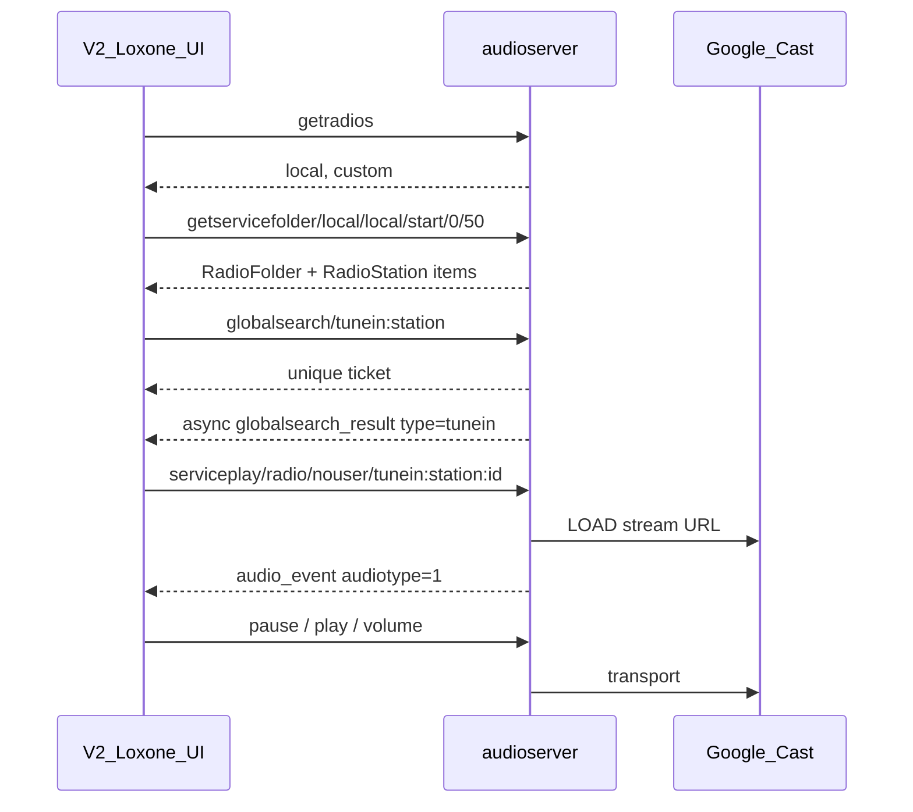

# Radio playback via TuneIn + Google Cast

V2 Loxone UI wire commands for radio, implemented in this audioserver.

## Architecture



No stream proxy: the Cast device fetches the HTTPS URL directly.

## V2 wire matrix

| Command | Response | Module |
|---------|----------|--------|
| `audio/cfg/getradios` | `getradios_result: [{cmd, name, icon, root}]` | [`bootstrap.rs`](../src/remote/handlers/bootstrap.rs) |
| `audio/cfg/getservicefolder/{svc}/{user}/{folder}/{start}/{max}` | `getservicefolder_result: [BrowseResult]` | [`radio/tunein_browse.rs`](../src/radio/tunein_browse.rs) |
| `audio/cfg/globalsearch/describe` | `tunein: [station, custom]` | [`browse.rs`](../src/remote/handlers/browse.rs) |
| `audio/cfg/globalsearch/tunein:station#N,custom#N/{query}` | ticket + async `type: tunein` | [`radio/tunein_search.rs`](../src/radio/tunein_search.rs) |
| `audio/cfg/search/radio/{user}/{tag}/arr/{start}/{max}` | `search_result: [{ results: [{ where: radio, tag, totalitems, items }] }]` | TuneIn/custom category drill-down; `arr` resolves via cached globalsearch query (up to 50 items) | [`radio/tunein_search.rs`](../src/radio/tunein_search.rs) |

TuneIn async broadcast uses a **flat** `globalsearch_result` (`station` / `custom` categories directly, no `error`/`result` wrapper) — see reference `notifier.ts` tunein branch.
| `audio/{id}/serviceplay/radio/nouser/{audiopath}` | `serviceplay_result` | [`radio/audiopath.rs`](../src/radio/audiopath.rs) `parse_serviceplay_item_id` |
| `audio/{id}/play` / `pause` / `volume/{n}` | transport (Cast when radio mode) | [`coordinator.rs`](../src/coordinator/mod.rs) |
| `audio/cfg/radios/add/{name}/{url}` | `radios_result` + `customurl_changed_event` | [`browse.rs`](../src/remote/handlers/browse.rs) |
| `audio/cfg/radios/del/{id}` | same | same |
| `audio/cfg/radios/modify/{id}/{name}/{url}` | same | same |
| `PUT /audio/cfg/radios/coverurl/{id}` | HTTP 200 + `{}` (raw image body); emits `customurl_changed_event: []` | [`ws.rs`](../src/remote/ws.rs), [`custom_streams.rs`](../src/radio/custom_streams.rs) |
| `GET /audio/cfg/radios/coverurl/{id}` | stored cover bytes (`Content-Type: image/jpeg` etc.) | same |

After add/modify/cover upload the server pushes `{"customurl_changed_event":[]}` on 7091 (and 7095) so the custom radio browse list reloads. `coverurl` includes `?v={timestamp}` to bust the client cover cache when the image changes.

### Play path (V2)

```
audio/{playerId}/serviceplay/radio/nouser/tunein:station:{id}
```

Not `serviceplay/spotify/…`. `parentpath` suffixes are Spotify-only.

### Browse item shape

| Kind | `type` | Fields |
|------|--------|--------|
| Folder | `1` | `id`, `name`, `audiopath` |
| Station | `2` | `audiopath`, `station`, `coverurl`, optional `streamurl` |

### Player state (`audio_event`)

| Source | `audiotype` | `audiopath` |
|--------|-------------|-------------|
| TuneIn | `1` | `tunein:station:{id}` |
| Custom | `0` | `custom:station:{id}` |

`duration` and `time` are always `0`.

## Cast device mapping

Radio playback requires an explicit **`cast_device_id`** per zone in `audioserver-config.json` `players[]` (Google Cast mDNS TXT `id=` — 32 hex chars, no hyphens).

1. Discover Cast speakers on the LAN: `dns-sd -B _googlecast._tcp`, then `dns-sd -L "<instance>" _googlecast._tcp` and copy the TXT `id=`
2. Set `cast_device_id` on that zone's row in `audioserver-config.json` and restart the daemon
3. Radio `serviceplay` resolves Cast **only** by that id (no auto-match heuristics)

Implementation: [`cast/matcher.rs`](../src/cast/matcher.rs)

### Zone types

| Mapping | Radio |
|---------|-------|
| `cast_device_id` set (e.g. Beoplay M3, Mu-so Qb 2) | Yes |
| No `cast_device_id` | **Offline** (idle until mapped) |

If `cast_device_id` is configured but the speaker is not on LAN, playback fails immediately (no fallback to other discovery methods).

## Cast remote sync

Volume and transport changes on the Cast receiver are mirrored back to Loxone via oxicast events ([`cast/sync.rs`](../src/cast/sync.rs), [`cast/manager.rs`](../src/cast/manager.rs)):

| Cast event | Loxone effect |
|------------|---------------|
| `ReceiverStatusChanged` | Update zone volume; if Default Media Receiver app disappears after playback started → clear zone |
| `MediaStatusChanged` | Update play/pause; idle+reason after playback → clear zone (transport only — not volume) |
| `MediaSessionEnded` | Clear radio zone when confirmed; spurious ends within 2s of last Cast transport are ignored by [`ZoneRegistry`](../src/zone_registry.rs) grace window |
| `Disconnected` / listener exit | Force-clear zone (bypass grace) — speaker switched source or Cast link lost |

- Muted receiver → UI shows `volume: 0` (stored level kept for unmute)
- Per-zone volume is persisted in `audioserver-config.json` (`players[].volume_level` / `volume_muted`) and survives audioserver restart; `play_radio` restores the saved level on Cast load
- Miniserver `audio/cfg/volumes` only **seeds** zones with no saved level yet — it does not overwrite user-adjusted volume
- Loxone-initiated volume/play/pause still drives Cast; echo events are deduped in [`ZoneRegistry`](../src/zone_registry.rs) before fan-out
- Stale Cast receiver volume echoes (arriving late after a UI volume step) are ignored for 2s so slow repeated volume presses do not jump backward
- Spurious `SessionEnded` (receiver app flicker, idle media status) during active playback no longer flashes “no music selected” — the registry ignores `Clear` while Cast still owns the zone within the grace window
- If Cast transport fails (stale session after speaker source switch), the coordinator force-clears the zone and publishes idle so the user can start radio again
- **Limitation:** some speakers adjust local amp volume without updating Cast receiver volume — not visible to the audioserver

## Multi-client UI sync

When one Loxone UI device starts radio on a zone, other UI clients on the same audioserver must show that zone as playing without reopening the radio browse folder.

| Mechanism | Source | Behavior |
|-----------|--------|----------|
| Live updates | `ZoneRegistry` → `IoEvent::State` broadcast | Single publish path; Cast ownership blocks other producers' overwrites |
| Connect burst | `fetch_connect_player_states` → `IoCommand::Status` | Reads authoritative registry snapshot (no duplicate watch pass) |
| Lag recovery | `resync_connect_audio_events` → `IoCommand::Status` | Same authoritative registry snapshot as connect bootstrap |
| Poll | `audio/{id}/status`, `audio/cfg/getplayersdetails` | Registry snapshot with Cast fallback seed on first query |

Status queries prefer Cast radio state (enriched like fan-out: Loxone envelope, cover proxy, EQ bands). Live Cast volume is not overwritten by Miniserver config defaults on status.

**Manual check:** play radio on device A → open the same audioserver on device B → zone shows station name and play state immediately.

## Manual test matrix

1. UI → Radios → TuneIn → pick station → play on zone with `cast_device_id` configured
2. Global search `tunein:station#5,custom#5/{query}` → play result
3. Pause / resume / volume on radio zone (Cast transport)
4. Hardware volume on speaker → Loxone mini player updates
5. Pause/resume on speaker → Loxone UI follows
6. Stop on speaker → zone cleared; UI idle; new play needs `serviceplay`
7. Add custom stream via `radios/add` → appears under Custom → plays
8. Edit custom stream with cover image → `PUT /audio/cfg/radios/coverurl/{id}` then `radios/modify` → cover visible in browse
9. Two zones, two stations concurrently (parallel Cast sessions)
10. Play radio on UI device A → open same audioserver on UI device B → zone shows playing (multi-client sync)

## Config / data files

- Custom streams: `custom-radios.json` in working directory; cover images in `custom-radio-covers/` beside that file
- **`cast_device_id`** per zone in `audioserver-config.json`

## Dependencies

- In-tree [`radio/tunein_api.rs`](../src/radio/tunein_api.rs) — TuneIn OPML client (reqwest + rustls)
- `oxicast` — async Cast LOAD / play / pause / volume (tokio-native)

## TuneIn API reference (external)

Unofficial OPML documentation for the same endpoints we call (`https://opml.radiotime.com`). Useful when debugging browse trees, outline fields (`key`, `guide_id`, nested `children`), or search row shapes — not Loxone wire formatting.

- **Site:** [tunein-api.corehacked.com](https://tunein-api.corehacked.com)
- **Browse:** [Browse endpoint](https://tunein-api.corehacked.com/endpoints-and-streaming/endpoints/browse-endpoint.md) (`Browse.ashx`, `c=` / `id=`)
- **Search:** [Search endpoint](https://tunein-api.corehacked.com/endpoints-and-streaming/endpoints/search-endpoint.md) (`Search.ashx`)
- **Stream resolve:** [Tune endpoint](https://tunein-api.corehacked.com/endpoints-and-streaming/endpoints/tune-endpoint.md) (`Tune.ashx`; we use `&render=json` for direct stream URLs instead of M3U)

We append `&render=json` to all requests; the docs often show XML but the JSON shape matches our `TuneInRow` / `StreamLink` types in `tunein_api.rs`.

TuneIn pivot subfolders (e.g. **Most Popular** under **All Stations**) use outline URLs with extra query params (`filter`, `pivot`). Browse resolution replays the full `Browse.ashx` query from the row URL, not just the `id=` value.
