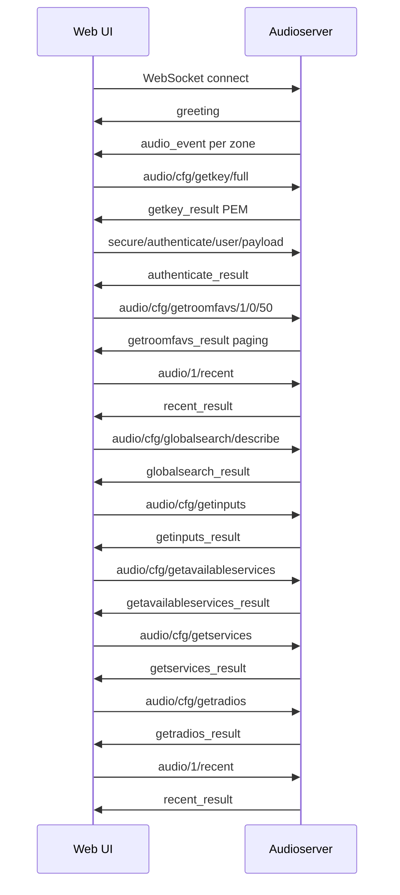
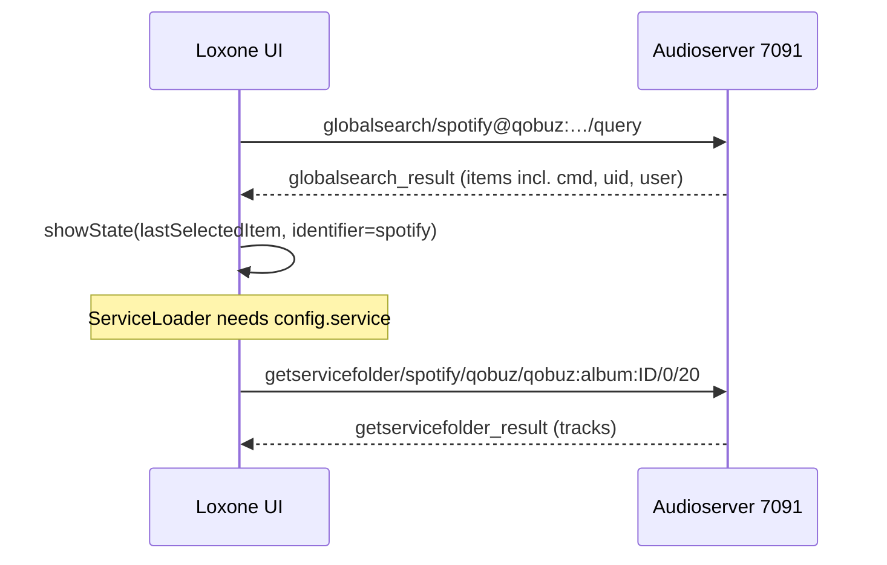
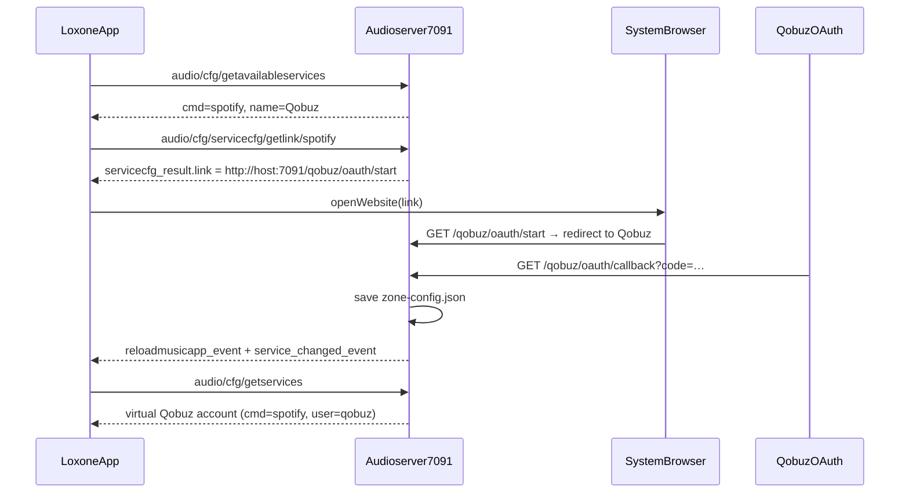
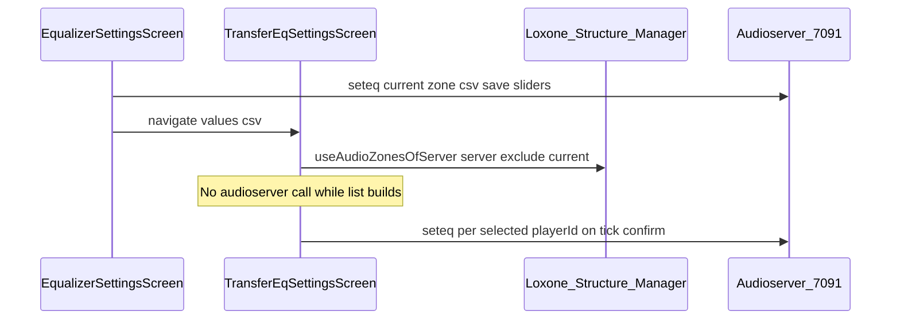

# Loxone Web UI ↔ Audioserver protocol (port 7091)

Reference for WebSocket traffic between the **Loxone app / Web UI** (remote control) and this Audioserver. Ground truth: [`trace.txt`](../reference/loxone-ui/trace.txt) and [`trace-7095.txt`](../reference/loxone-ui/trace-7095.txt) (captures of **native Loxone UI clients against this backend**, not official Loxone hardware), [`src/remote/mod.rs`](../src/remote/mod.rs), [`src/wire_response.rs`](../src/wire_response.rs), community reference [lox-audioserver `dev`](https://github.com/lox-audioserver/lox-audioserver/tree/dev), minified UI bundles `scripts6.js` / `controls1.js` / `comps.js` (newer media schemas), and the searchable appendix [`ui-wire-commands.md`](ui-wire-commands.md) / [`ui-wire-commands.json`](ui-wire-commands.json).

**Wire key order:** Command replies use `{name}_result` before `command` (see `build_wire_result_response`). Native clients often tolerate both orderings; web `MediaMessageParser` in `scripts6.js` may require result-first for some flows.

Miniserver pairing (7095) is documented in [`miniserver-protocol.md`](miniserver-protocol.md).

> **Qobuz removed (Nov 2026):** sections below that describe Qobuz browse, the virtual Spotify bridge, `servicecfg` login and the queue panel document the earlier Qobuz Connect build. Today `getservices` / `getavailableservices` return `[]`, `getqueue` returns an empty queue, and the Qobuz-only commands (`servicecfg/*`, `isfollowed`, `getplaylists2`, `library/play`, `playlist/play`, `queue/play|remove|move`, `diagnosis`) return empty stubs. Radio, room favorites, EQ and transport sections still apply. The wire shapes are kept here as reference for future service integrations.

**Dual-path caveat:** This document reflects [`trace.txt`](../reference/loxone-ui/trace.txt) (7091 bootstrap and browse). In a captured session with Loxone mobile + desktop, **7091 and 7095 were both active** — not either/or. Full matrix: [traffic-paths.md](traffic-paths.md). Play/skip on **7095**: [miniserver-protocol.md — Zone transport](miniserver-protocol.md#zone-transport-commands-7095).

### Observed routing (7091 focus)

From `command-audit.log` (119 commands, `LOXONE_AUDIT=1`). Four `getkey/full` bursts ≈ four UI reconnects (mobile + desktop). Re-capture after firmware upgrades.

| On **7091** (this port) | Examples |
|-------------------------|----------|
| Bootstrap | `audio/cfg/getkey/full`, `secure/authenticate/...` |
| Library / browse | `getservices`, `getradios`, `getservicefolder`, `globalsearch`, `getplaylists2`, `getmediafolder`, `recent` |
| Transport (UI) | `volume/+1`, `volume/-1`, `repeat/1`, `position/{seconds}`, `getqueue` |
| Zone prefs | `loudness` (GET during bootstrap / zone settings) |
| Equalizer | `geteq`, `seteq` (zone EQ screen; transfer uses `seteq` only on confirm) |

| Not seen on 7091 in this capture | Port that received it |
|----------------------------------|------------------------|
| `play`, `queueplus`, `queueminus` | **7095** |
| `volume/{n}` (absolute) | **7095** (+ `audio/cfg/volumes`) |
| Pairing, `ready`, structure `volumes` sync | **7095** |
| `status` | *not exercised* |
| `pause` | **7095** |

**Takeaway:** Document 7091 for **music-app wire format** (bootstrap + browse + vol+/−/repeat/seek). Do not assume **play** arrives here — verify with `LOXONE_AUDIT=1` or `RUST_LOG=loxone_audioserver=info`.

## Document conventions

Each **command** section uses:

| Block | Content |
|-------|---------|
| **Path** | Wire command line |
| **Direction** | Client → server or push |
| **Purpose** | UI feature that triggers it |
| **Request** / **Response** | Parameters and `*_result` JSON |
| **Fields** | Field \| Type \| Meaning (or *unknown*) |
| **Current** | This repo (`remote/mod.rs`) |
| **Reference** | lox-audioserver handler |
| **UI scripts** | **Confirmed** = literal in `scripts6.js`; **Inferred** = `controls1.js` / control behavior |

**Trace caveat:** Exports may glue frames — e.g. [`trace.txt`](../reference/loxone-ui/trace.txt) line 29 merges `recent`, `globalsearch/describe`, `getinputs`, `getavailableservices`, `getservices` on one line. Diagrams use logical order.

---

## Transport and framing

| Item | Value |
|------|--------|
| Port | **7091** TCP (`remote::start`) |
| Subprotocol | `Sec-WebSocket-Protocol: remotecontrol` |
| Discovery | UDP **7070** advertises serial; client connects to **7091** |

### Message types

Same as 7095 (see [shared mechanics](miniserver-protocol.md#transport-and-framing)):

1. **Greeting** — plain text, first server frame.
2. **Command** — client line `audio/...` or `secure/...`.
3. **Response** — JSON `{ "command": "…", "<name>_result": … }`.
4. **Push** — `{"audio_event":[…]}` (no `hw_event` on 7091; `IoEvent::HardwareState` is ignored).

### Greeting format (7091)

```
LWSS V {version} | ~API:{api_version}~ | Session-Token: {token}
```

No `MINISERVER` prefix or serial segment (unlike 7095). Example from trace:

```
LWSS V 17.1.05.05 | ~API:1.6~ | Session-Token: 8WahwAfU...
```

**Note:** Trace line 1 may glue greeting + first `audio_event` JSON; treat as export artifact.

### Result naming

Last path segment → `*_result`, except dynamic segments (e.g. `position/{n}` → `position_result`). Implemented via `infer_result_name` / `build_response` in [`remote/mod.rs`](../src/remote/mod.rs).

### Album art (`coverurl`) and `/cors-proxy`

The Loxone UI cannot load HTTPS cover images directly (browser CORS). When a track has cover art, `audio_event` / `status_result` set:

```text
http://<audioserver-host>:7091/cors-proxy?url=<encoded-https-url>&id=<album>
```

- **Host** must be this daemon’s reachable address (`AppConfig.public_host`), **not** Miniserver `config.ip` from `state.json` (that field is the Miniserver address).
- At `serve` startup: auto-detect LAN IPv4, or override with `--public-host <host-or-ip>`.
- HTTP handler: `GET /cors-proxy` on port **7091** (same axum server as WebSocket). Fetches the upstream URL server-side and returns bytes with `Access-Control-Allow-Origin: *`.

---

## Bootstrap sequence (reference trace)

Logical order from [`trace.txt`](../reference/loxone-ui/trace.txt):



Additional startup commands appear in [`tracing.log`](../tracing.log) on some sessions (not in `trace.txt`): `audio/{id}/status`, `audio/cfg/scanstatus`, `audio/cfg/getsyncedplayers` — see [Section B](#section-b--on-demand-commands).

---

## Section A — Ordered bootstrap commands

### Connect push: `audio_event`

| | |
|--|--|
| **Direction** | Audioserver → UI (unsolicited) |
| **When** | After greeting; again on `IoEvent::State` |
| **Purpose** | Zone cards / transport bar state |

Envelope: `{ "audio_event": [ PlayerState, … ] }`. Uses [`connected_idle_state`](../src/player_state.rs) on connect (no `players` array; omits empty optional fields).

| Implementation | Behavior |
|----------------|----------|
| **Current** | `push_initial_audio_events` → `fetch_connect_player_states` (live per zone, idle fallback); coordinator broadcasts. Radio zones use [`CastPlaybackManager`](../src/cast/manager.rs) in `Status` / `getplayersdetails`, not only the Qobuz bridge. |
| **Reference** | Zone notifier → `audio_event` |
| **UI scripts** | **Inferred** — UI subscribes to WS pushes (no literal `audio_event` in `controls1.js`) |

---

### `audio/cfg/getkey/full`

| | |
|--|--|
| **Purpose** | Fetch SPKI public key before `secure/authenticate` |
| **Response** | `getkey_result`: `[{ "pubkey": "<PEM>" }]` |

| Implementation | Behavior |
|----------------|----------|
| **Current** | RSA public key from `app_config.key_pair` |
| **Reference** | `configHandlers.getKeyFull` |
| **UI scripts** | **Confirmed** — `NEW_LOGIN_HANDLING` feature gates newer login; path `audio/cfg/getkey` also in `scripts6.js` |

---

### `secure/authenticate/{user}/{tuple}/{ciphertext}`

| | |
|--|--|
| **Purpose** | Decrypt Miniserver user token with audioserver private key |
| **Request** | `tuple` = URI-encoded encrypted `{key}:{iv}:{session_token}`; `ciphertext` = AES-CBC user token |
| **Response** | `authenticate_result` |

| Field | Type | Trace / code |
|-------|------|----------------|
| `authenticate_result` | string **or** array | Trace: `"authentication successful"`; `authenticate_false` returns `[]` |

| Implementation | Behavior |
|----------------|----------|
| **Current** | **Intentional stub** — always `"authentication successful"`; params are parsed but not decrypted |
| **Security model** | **7091 bootstrap handshake only** — not an authorization boundary. Real pairing and crypto are on **7095** via [`secure_session.rs`](../src/miniserver/secure_session.rs) (`secure/hello`, `secure/init`). See [miniserver-protocol.md](miniserver-protocol.md). |
| **Reference** | Stock `secureHandlers.authenticate` — full RSA/AES decrypt + Miniserver `checktoken` (not implemented here) |
| **Code** | [`handlers/secure.rs`](../src/remote/handlers/secure.rs) |
| **UI scripts** | **Inferred** — sent after `getkey/full` when `MediaEnum.Features.NEW_LOGIN_HANDLING` |

Variant: `secure/authenticate/{user}/false/{signature}` → `authenticate_result: []` (logout stub).

**Future work** (if product requires real 7091 auth): decrypt tuple with audioserver private key, AES-CBC ciphertext, validate `session_token`, call Miniserver `jdev/sys/checktoken/{token}/{user}`.

---

### `audio/cfg/getroomfavs/{playerid}/{start}/{max_items}`

| | |
|--|--|
| **Purpose** | Paged room favorites for zone |
| **Response** | `getroomfavs_result`: **array** of one page object |

| Field | Type | Meaning |
|-------|------|---------|
| `id` | number | `playerid` |
| `type` | number | `4` = room fav list |
| `start` | number | Page offset |
| `totalitems` | number | Total count |
| `items` | array | Room favorite rows (`id`, `slot`, `plus`, `name`, `audiopath`, `type`, `service`, `serviceType`, …) |

| Implementation | Behavior |
|----------------|----------|
| **Current** | Loaded from `players[].room_favorites` in `audioserver-config.json` ([`config/zone.rs`](../src/config/zone.rs)); paged by `start` / `max_items` |
| **Reference** | `zoneHandlers.audioCfgGetRoomFavs` |
| **UI scripts** | **Confirmed** — `ZONE_FAV.*` in `MediaEnum.AudioCommands` (`roomfav/play/`, etc.) |

---

### `audio/cfg/roomfavs/{playerid}/{action}/…`

| | |
|--|--|
| **Purpose** | Room favorite CRUD (add, delete, setname, setid, reorder, copy) |
| **7091** | Yes |
| **Persistence** | `audioserver-config.json` `players[].room_favorites` ([`config/zone.rs`](../src/config/zone.rs)) |

| action | Response key | Payload |
|--------|--------------|---------|
| `add` | `roomfavs_add_result` | `{ id, name }` |
| `delete` | `roomfavs_delete_result` | `{ delete_id }` |
| `setname` | `roomfavs_setname_result` | `{ id, name }` |
| `setid` | `roomfavs_set_result` | `{ changed_from, changed_to }` |
| `reorder` | `roomfavs_reorder_result` | `"ok"` |
| `copy` | `roomfavs_copy_result` | `"ok"` |

Example add: `audio/cfg/roomfavs/3/add/VRT%20Studio%20Brussel/tunein:station:s2611`

After mutations the server emits `roomfavchanged_event` with `{ playerid, count }`.

Zone rows (and favorites) are **pruned** when Loxone Config `setconfig` no longer lists that `playerid` ([`prune_players_not_in_loxone_zones`](../src/config/mapping.rs)).

---

### `audio/{playerid}/roomfav/play/{favorite_id}`

| | |
|--|--|
| **Purpose** | Play a saved room favorite (TuneIn/custom → Cast; Qobuz → Connect) |
| **Response** | `roomfav_result`: `[{ playerid, playing_slot }]` |

Also: `roomfav/delete`, `roomfav/save/` (from live status), `roomfav/savepath/{*audiopath}`.

---

### `audio/{playerid}/recent` and `audio/{playerid}/recent/{start}`

| | |
|--|--|
| **Purpose** | **Recently played** browse list (media folder “Recently Played”) — **not** a replacement for [`audio/{id}/status`](#zone-transport) |
| **Response** | `recent_result`: `{ "ts": <unix>, "items": [ RecentItem, … ] }` |

Each `RecentItem` includes `audiopath`, `coverurl`, `title`, `artist`, `album`, `service` (`"spotify"` for Qobuz bridge compat), `serviceType` (`3`), `type` (`2` = track), `owner` / `owner_id` (`"qobuz"`).

| Implementation | Behavior |
|----------------|----------|
| **Current** | [`recents.rs`](../src/recents.rs): JSON store `recents/{playerid}.json` (max 5, dedupe by `audiopath`). Records when a zone starts a **new** recordable audiopath; nothing records since the Qobuz controller was removed, so lists only hold earlier entries. Optional `{start}` slices `items`. |
| **Reference** | `zoneHandlers.audioRecent` → `RecentsManager` |
| **UI scripts** | **Confirmed** — `GetRecentPlayedScheme` in `comps.js`; called at bootstrap (often twice per zone). Live zone state remains `audio_event` / `status`. |

---

### `audio/cfg/globalsearch/describe`

| | |
|--|--|
| **Purpose** | Which entity types each search provider supports |
| **Response** | `globalsearch_result`: object map provider → type list |

Trace example: `spotify`, `local`, `tunein` keys with string arrays.

| Implementation | Behavior |
|----------------|----------|
| **Current** | Fixed map matching trace; includes `qobuz: ["track", "album", "artist", "playlist"]` when logged in |
| **Reference** | `contentManager.globalSearchDescribe` |
| **UI scripts** | **Confirmed** — `audio/cfg/globalsearch/describe` and `audio/cfg/globalsearch/` prefix |

---

### `audio/cfg/globalsearch/{providerSpec}/{query}`

| | |
|--|--|
| **Purpose** | Global search across configured providers |
| **Example** | `audio/cfg/globalsearch/spotify@qobuz:track#5,album#5,artist#5,playlist#5,episode#5,show#5/beatles` |
| **Flow** | Immediate ack with `unique`, then async broadcast with full results (same `unique`, top-level `type`) |

**Immediate response**

```json
{
  "globalsearch_result": { "unique": "gs-1716478021234" },
  "command": "audio/cfg/globalsearch/spotify@qobuz:track#5/beatles"
}
```

**Spotify broadcast** (reference [lox-audioserver `notifier.ts`](https://github.com/lox-audioserver/lox-audioserver/blob/dev/src/adapters/loxone/ws/notifier.ts); golden fixture `tests/fixtures/globalsearch_spotify_qobuz_beatles.json` (removed)):

```json
{
  "globalsearch_result": {
    "error": 0,
    "result": {
      "tracks": {
        "caption": "Tracks",
        "count": 1,
        "items": [ { "id": "qobuz:track:123", "name": "Come Together", "type": 2, "…": "…" } ],
        "link": "audio/cfg/search/spotify/noUser/track/beatles/0/50",
        "totalitems": 42
      },
      "shows": { "caption": "Podcasts", "count": 0, "items": [], "link": "…", "totalitems": 0 },
      "episodes": { "caption": "Episodes", "count": 0, "items": [], "link": "…", "totalitems": 0 },
      "topresults": {
        "caption": "Top results",
        "count": 1,
        "tracks": [ { "…": "…" } ],
        "albums": [],
        "artists": [],
        "playlists": []
      },
      "user": "qobuz",
      "service": { "cmd": "spotify", "id": "qobuz", "user": "qobuz", "uid": "spotify/qobuz", "fake": true, "provider": "qobuz" }
    }
  },
  "type": "spotify",
  "unique": "gs-1716478021234"
}
```

| Field | Notes |
|-------|--------|
| `result.user` | Virtual Spotify account id (`qobuz` when logged in, else `noUser`) — matches `getservices.user` |
| `result.service` | `getservices`-shaped stub (`cmd`, `id`, `user`, `uid`) |
| Browsable item `cmd` / `uid` / `user` | Copied onto album/artist/playlist rows (`type` 12) so V1 can use `lastSelectedItem` as `config.service` |
| Browsable item `service` | Nested duplicate of the same stub |
| Category `count` | Number of items returned in this page (reference always includes it) |
| `shows` / `episodes` | Required when describe advertises them; Qobuz bridge returns empty categories |
| `topresults` | First hit per type (`tracks`, `albums`, `artists`, `playlists` arrays — not `.items`) |
| Search item `name` | Plain title (not `"Title — Artist (Album)"` composite used in browse) |
| Category `link` | `audio/cfg/search/spotify/{user}/{type}/{query}/0/50` for “Show more” — returns `search_reply_result` (V2 `SearchScheme`) via `search_category_browse` (removed); rows use `spotify:album:` / `spotify:track:` audiopaths |
| Search item `contentType` / `mediaType` | Match service browse (`Service`/`service` for tracks/albums/artists; `Playlists`/`playlist` for playlists) |

| Implementation | Behavior |
|----------------|----------|
| **Current** | Qobuz / `spotify@*` provider specs search REST catalog; broadcast shape matches reference |
| **Reference** | `contentManager.globalSearch` + `notifyGlobalSearchResult` |
| **UI scripts** | **Confirmed** — `GlobalSearchExt` reads `globalsearch_result.result` when `type === "spotify"` |

---

### Global search drill-down (opening albums / artists / playlists)

Search hits are only useful if tapping a browsable row loads tracks. That requires a **second** wire command (`getservicefolder` or `searchdetails`). If you see globalsearch results but **no** follow-up command in `command-audit.log`, the Loxone UI never bound a service account to `ServiceLoader` — not a Qobuz API failure.

#### UI flow (`scripts6.js`, V2 firmware)

1. User runs `audio/cfg/globalsearch/…` → async `globalsearch_result` broadcast (categories + items).
2. User taps an album → `GlobalSearchExt.createAudioResultCell` calls `showState` with `lastSelectedItem`, `identifier: "spotify"`, `username` from `getCurrentServices` / persisted Spotify account — **without** a top-level `service` property in that config.
3. The album screen’s `ServiceLoader` runs only when `this.service` is set via `config.service` (`MediaEnum.Attr.SERVICE._` is the string `"service"`).
4. `getAcquireCommand()` returns `getservicefolder/` + `service.uid` + `/` + `{folderId}/{start}/{maxItems}`.

**V1 firmware:** `getCellConfigWithServiceItem` copies `config.service = config.lastSelectedItem` when missing. The **search item itself** must therefore carry `cmd`, `uid`, and `user` at the **root** of the JSON object (not only nested under `service`).

**V2 firmware:** that copy is skipped. The UI must obtain `config.service` elsewhere (typically by matching `identifier` + `username` against `getservices_result`). `result.user` and `getservices.user` must agree (`qobuz` when logged in).



#### Expected wire command after opening an album

Primary path (matches service-tree browse in audit logs):

```http
audio/cfg/getservicefolder/spotify/qobuz/qobuz:album:{albumId}/0/20
```

Here `spotify/qobuz` is `service.uid` from `getservices` (`cmd` + `/` + `user`). The third segment is the folder id (`qobuz:album:…`), not a separate “username” in the loader template.

Alternate routes (registered, same handler as `getservicefolder`):

- `audio/cfg/getservicefolder/spotify/{folderId}/{start}/{max}` — four segments after `getservicefolder` (no explicit account segment in the path).
- `audio/cfg/searchdetails/spotify/qobuz/{folderId}/{start}/{max}` — used by library `SearchDetailLoader`, not `GlobalSearchExt`.

#### Server requirements (this repo)

Implemented in `src/qconnect/browse.rs` (removed) and [`src/remote/mod.rs`](../src/remote/mod.rs):

| Requirement | Why |
|-------------|-----|
| `getservices_result[].user` = `qobuz` | Account segment in `getservicefolder/spotify/qobuz/…`; must match `result.user` and item `user`. Email lives only in `email`. |
| `getservices_result[].uid` = `spotify/qobuz` | Optional but explicit; UI also computes `uid` as `cmd + "/" + user` in `_sanitizeServices`. |
| Each browsable search item includes **`cmd`, `uid`, `user`, `fake`, `provider` on the item root** | V1 uses `lastSelectedItem` as `config.service`; those fields are what `ServiceLoader` reads. |
| Nested `service` object on items + `result.service` | Same stub for clients that read `item.service` directly. |
| Browsable search rows use **`type: 12`** (`FILE_TYPE_SERVICE_ITEM`) | Aligns with service browse rows (e.g. artists in the tree); `type: 7` is `PLAYLIST_BROWSABLE` in the UI enum and is still “browsable” but we standardize on 12 for service hits. |
| Tracks use **`type: 2`** | Play via `playurl` / `serviceplay`, not folder drill-down. |

**Example album row** (fields the UI needs on the object that becomes `config.service` on V1):

```json
{
  "id": "qobuz:album:0634904032432",
  "audiopath": "qobuz:album:0634904032432",
  "name": "In Rainbows",
  "type": 12,
  "tag": "album",
  "contentType": "Service",
  "mediaType": "service",
  "cmd": "spotify",
  "user": "qobuz",
  "uid": "spotify/qobuz",
  "fake": true,
  "provider": "qobuz",
  "service": { "cmd": "spotify", "id": "qobuz", "user": "qobuz", "uid": "spotify/qobuz", "fake": true, "provider": "qobuz" }
}
```

#### Debugging checklist

| Symptom | Likely cause |
|---------|----------------|
| Search list renders, opening album shows empty rows, **no** new line in audit log | Missing `config.service` / missing `cmd`+`uid`+`user` on items (fixed by flattening account fields). |
| `getservicefolder` arrives but 404 / empty `items` | Wrong `folderId` or Qobuz not logged in — separate from UI binding. |
| Wrong account segment (`…/spotify/email@…/…` vs `…/spotify/qobuz/…`) | `getservices.user` not aligned with virtual account id; use `qobuz`, not email, for `user`/`uid`. |

Golden fixture: `tests/fixtures/globalsearch_spotify_qobuz_beatles.json` (removed). Implementation reference: `GlobalSearchExt`, `ServiceLoader`, `getCellConfigWithServiceItem` in `scripts6.js` (UI bundle, read-only in this repo).

---

| | |
|--|--|
| **Response** | `getinputs_result`: `[]` |

| Implementation | Behavior |
|----------------|----------|
| **Current** | Empty array |
| **Reference** | `configHandlers.getInputs` |
| **UI scripts** | **Confirmed** — `audio/cfg/getinputs`; feature `DYNAMIC_INPUTS` |

---

## Virtual Spotify bridge (Qobuz and the `cmd` discriminated union)

The Loxone app does **not** treat streaming providers as an open-ended string. Newer builds validate audioserver JSON with **Zod discriminated unions** in `comps.js`. That is why this project exposes Qobuz as a **virtual Spotify account** (`cmd: "spotify"`, `id: "qobuz"`, `fake: true`) instead of `cmd: "qobuz"`.

### What the UI allows on the wire

| Schema (`comps.js`) | Allowed `cmd` values | Unknown `cmd` (e.g. `"qobuz"`) |
|---------------------|----------------------|--------------------------------|
| `AvailableServicesScheme` (`getavailableservices`) | `spotify`, `soundsuit` | **Dropped** in response preprocess before the UI sees the row |
| `ServiceConfigsScheme` (`getservices`) | `spotify`, `soundsuit` | Parse/validation fails or row is unusable |
| `AddServiceScheme` (`servicecfg/add`) | `spotify`, `soundsuit` (+ password) | Not representable |
| `GetLinkSchema` (`servicecfg/getlink`) | `spotify`, `soundsuit` | Not representable |

Relevant extract (simplified from `GetAvailableServicesScheme`):

```javascript
const spotify = base.extend({ cmd: z.literal("spotify") });
const soundsuit = base.extend({ cmd: z.literal("soundsuit") });
const union = z.discriminatedUnion("cmd", [spotify, soundsuit]);

getavailableservices_result: z.preprocess(
  (rows) => Array.isArray(rows)
    ? rows.filter((row) => union.options.map((o) => o.shape.cmd.value).includes(row.cmd))
    : rows,
  z.array(union)
);
```

There is **no** `literal("qobuz")` anywhere in `comps.js`. Audioserver API version in the 7091 greeting (`~API:1.6~`) enables **feature flags** (e.g. `SpotifySoundsuitNewLogin`, `V2_FIRMWARE`, `GLOBAL_SEARCH`) but does **not** widen these unions at runtime — the allowed `cmd` set is fixed in the app bundle.

### Legacy `scripts6.js` vs typed `comps.js`

`scripts6.js` defines `MediaEnum.Service` (`spotify`, `googlemusic`, `amazon`, `local`, `lms`, `music`) for **client-side** comparisons on the older Audio Zone stack. That enum is **not** the same as the Zod union above: legacy code never adds `qobuz`, and the live Spotify settings flow in `comps.js` still keys off `cmd === "spotify"`. Returning `cmd: "qobuz"` in `getavailableservices` would not create a first-class Qobuz provider in the add-service dialog even on the legacy path.

### Why a virtual Spotify account

The UI builds browse and play paths from **`cmd` + `user`** (and `uid = cmd + "/" + user`):

```text
getservicefolder/spotify/qobuz/qobuz:album:…/0/20
globalsearch/spotify@qobuz:…
```

So for Qobuz we must:

1. Use **`cmd: "spotify"`** so rows pass `ServiceConfigsScheme` and match `MediaEnum.Service.SPOTIFY` checks.
2. Use **`user: "qobuz"`** (via `virtual_spotify_account_user()` (removed)) as the account segment — not the Qobuz email.
3. Set **`id: "qobuz"`** and **`provider: "qobuz"`** so the audioserver and search hits can tell bridge traffic from a real Spotify login.
4. Set **`fake: true`** (and emit **`uid: "spotify/qobuz"`** explicitly) so `ServiceLoader` / global search can bind drill-down.

Queue and now-playing reuse the same compatibility label: `audiotype: 5` = `MediaEnum.AudioItemType.SpotifyConnect` (`VIRTUAL_SPOTIFY_AUDIOTYPE` (removed)) — naming overlap with Loxone’s **Spotify Connect** setting, not the same protocol as Qobuz Connect.

### What we do *not* do

| Approach | Outcome |
|----------|---------|
| `getavailableservices` with `cmd: "qobuz"` | Filtered out by Zod; never shown as addable service |
| Real Spotify login via this audioserver | Replaced by Qobuz OAuth behind `cmd: "spotify"` wire compatibility |
| CLI `login` only | Still supported for headless setups; Loxone UI can use `servicecfg/getlink` when `serve` is running |

Stock [lox-audioserver](https://github.com/lox-audioserver/lox-audioserver) uses the same pattern for Apple Music / Tidal (virtual accounts under Spotify-shaped `cmd`). This repo exposes **Qobuz-branded** `getavailableservices` while keeping `cmd: "spotify"` for Zod validation.

**Implementation:** [`qobuz_service_entry()`](../src/remote/mod.rs), [`get_available_services()`](../src/remote/mod.rs), [Service account login (`servicecfg`)](#service-account-login-servicecfg), README § [Qobuz in the Loxone UI](../README.md#qobuz-in-the-loxone-ui-browse--services).

---

### `audio/cfg/getavailableservices`

| | |
|--|--|
| **Purpose** | Services the user can add (Spotify, Soundsuit on newer apps) |
| **Response** | `getavailableservices_result`: array of service descriptors |

| Field | Type | Meaning |
|-------|------|---------|
| `cmd` | string | **`spotify` or `soundsuit` only** in validated UI (`comps.js`); not `qobuz` — see [Virtual Spotify bridge](#virtual-spotify-bridge-qobuz-and-the-cmd-discriminated-union) |
| `name`, `icon`, `helplink`, `registerlink` | string | UI metadata |
| `config` | array | Login form fields (`name`, `type`, `regex`, `link`) |

| Implementation | Behavior |
|----------------|----------|
| **Current** | Qobuz-branded row with `cmd: "spotify"` (required by `comps.js`); OAuth via `servicecfg/getlink` |
| **Reference** | `AVAILABLE_SERVICES` (Spotify only); bridge providers use virtual accounts |
| **UI scripts** | **Confirmed** — `Commands.SERVICES.GET_AVAILABLE` → `audio/cfg/getavailableservices`; feature gate `SpotifySoundsuitNewLogin` for OAuth `getlink` flow |

---

## Service account login (`servicecfg`)

The Loxone app **Settings → Services → Add** flow uses the Spotify-shaped `servicecfg` commands even though this audioserver backs them with Qobuz OAuth. Requires firmware/API ~1.6+ (`SpotifySoundsuitNewLogin` feature flag in the app).

### Flow



### Commands

| Command | Response key | Purpose |
|---------|--------------|---------|
| `audio/cfg/servicecfg/getlink/spotify` | `servicecfg_result: { link }` | Browser OAuth entry (`http://{public_host}:7091/qobuz/oauth/start`) |
| `audio/cfg/servicecfg/add/spotify` | `servicecfg_result: { action: "added", id: "qobuz", user: "qobuz" }` | Ack after OAuth (or when already logged in) |
| `audio/cfg/servicecfg/delete/spotify/qobuz` | `servicecfg_result: { action: "deleted", error: 0 }` | Logout — clears `zone-config.json` auth fields |

### HTTP OAuth (port 7091)

| Route | Behavior |
|-------|----------|
| `GET /qobuz/oauth/start` | Redirects to Qobuz sign-in with callback `http://{public_host}:7091/qobuz/oauth/callback` |
| `GET /qobuz/oauth/callback` | Exchanges `code` / `code_autorisation`, saves credentials, broadcasts WS reload events |

The phone running the Loxone app must reach `{public_host}:7091` (same constraint as `/cors-proxy` cover art). Set `--public-host` on `serve` when auto-detect is wrong.

### WebSocket reload events

After login or logout the audioserver pushes (7091 and 7095):

- `reloadmusicapp_event`: `{ action: "useradd"|"userdel", cause: "spotify", reload: 1, user: "qobuz" }`
- `service_changed_event`: `{ action: "serviceschanged" }`

The UI listens for these and refetches `getservices`.

**Implementation (removed Nov 2026):** `service_cfg_get_link()`, `oauth_http.rs`, `run_playback_bridge_supervisor()`. Today `servicecfg/*` answers empty `servicecfg_result` objects ([`retired_command_reply`](../src/remote/mod.rs)).

---

### `audio/cfg/getservices`

| | |
|--|--|
| **Purpose** | Already-configured streaming services |
| **Response** | `getservices_result`: `[]` in trace |

| Field | Notes |
|-------|--------|
| `cmd` | **`"spotify"`** for the Qobuz bridge (required by UI schema — not `"qobuz"`) |
| `id` | Provider id `"qobuz"` (catalog), not the Loxone account segment |
| `user` | Virtual account id: **`qobuz`** when logged in, else `noUser` — used in `getservicefolder/spotify/{user}/…` and must match globalsearch `result.user` |
| `uid` | **`spotify/qobuz`** (or `spotify/noUser`); emitted explicitly so `ServiceLoader` can build `getservicefolder/{uid}/…` |
| `email` | Qobuz login email (display / diagnostics only; not the path segment) |
| `fake` | `true` for bridge accounts |
| `provider` | `"qobuz"` — distinguishes bridge from real Spotify in search/browse metadata |

| Implementation | Behavior |
|----------------|----------|
| **Current** | Empty list `[]` — no streaming accounts are advertised. Until Nov 2026 a logged-in Qobuz account appeared as one virtual Spotify entry as above (same bridge pattern as Apple Music / Tidal in [lox-audioserver](https://github.com/lox-audioserver/lox-audioserver)). |
| **Reference** | `spotifyServiceManager.listServiceEntries()` (real Spotify + bridge accounts) |
| **UI scripts** | **Confirmed** — `Commands.SERVICES.GET` → `audio/cfg/getservices`; client runs `_createUidForService` (`uid = cmd + "/" + user`) |

---

### `audio/cfg/getradios`

| | |
|--|--|
| **Purpose** | Radio / stream provider roots in UI |
| **Response** | `getradios_result`: array of `{ cmd, name, icon, root, editable?, description? }` |

| Implementation | Behavior |
|----------------|----------|
| **Current** | TuneIn presets and custom streams only |
| **Reference** | `configHandlers.getRadios` |
| **UI scripts** | **Confirmed** — `audio/cfg/getradios`; feature `DISABLE_RADIOS` |

---

## Section B — On-demand commands

All routes registered in [`Api::new`](../src/remote/mod.rs) (~1254–1402) not covered in the bootstrap trace above.

### Zone transport

Wire paths use `audio/{playerid}/…`. UI builds them via `MediaEnum.AudioCommands` (**confirmed** in `scripts6.js`). Zone controls call `MediaServerComp.sendAudioZoneCommand(playerid, { cmd: … })` (**confirmed** in `controls1.js` — no literal `audio/` strings in controls bundle).

Handlers live in [`zone_transport.rs`](../src/zone_transport.rs) (7095 via miniserver fallback; 7091 delegates transport to the same module). **Observed port** is from `command-audit.log` (mobile + desktop).

| Command | Response (typical) | Current | Reference | Observed port | UI scripts |
|---------|-------------------|---------|-----------|---------------|------------|
| `audio/{id}/play` | `play_result: []` | `IoCommand::Play` | `zoneHandlers.play` | **7095** | **Confirmed** `PLAY:"play"` |
| `audio/{id}/resume` | `resume_result: []` | `IoCommand::Play` (resume) | unpause from pause | **7095** | Loxone sends when tapping play while paused |
| `audio/{id}/pause` | `pause_result: []` | `IoCommand::Pause` | `zoneHandlers.pause` | **7095** | **Confirmed** `PAUSE:"pause"` |
| `audio/{id}/status` | `status_result: [PlayerState]` | Zone status via oneshot | `audioGetStatus` | — | **Confirmed** `STATUS:"status"` |
| `audio/{id}/volume/{n}` | `volume_result: []` | Absolute level — persisted in `zone-config.json` `players[].volume_level` | `zoneHandlers.volume` | **7095** | **Confirmed** `VOLUME.SET_TO:"volume/"` |
| `audio/{id}/volume/+`, `volume/-`, `volume/+1`, `volume/-1` | `volume_result: []` | Relative ± step (`volume_delta`) | same | **7091** | **Confirmed** `UP_BY` / `DOWN_BY` |
| `audio/{id}/volup`, `voldown` | `volume_result: []` | Fixed ±1 | same | — | **Confirmed** `UP:"volup"`, `DOWN:"voldown"` |
| `audio/{id}/position/{position}` | `position_result` | Seek/scrub — `position` is **seconds** on wire, sent to Connect as `current_position` ms | `zoneHandlers.seek` | **7091** | **Confirmed** `SEEK.TO:"position/"` |
| `audio/{id}/queueplus` | `queueplus_result: []` | `IoCommand::Next` | skip track | **7095** | **Confirmed** `QUEUE.NEXT` |
| `audio/{id}/queueminus` | `queueminus_result: []` | `IoCommand::Previous` | previous | **7095** | **Confirmed** `QUEUE.PREV` |
| `audio/{id}/repeat/{mode}` | `repeat_result: []` | `IoCommand::Repeat` | repeat mode | **7091** | **Confirmed** `REPEAT.*` |
| `audio/{id}/shuffle` | `shuffle_result: []` | `IoCommand::Shuffle` | shuffle toggle | — | **Confirmed** `SHUFFLE.ON/OFF` |
| `audio/{id}/loudness` | `loudness_result: <boolean>` | Read per-zone preference ([`zone_audio_prefs.rs`](../src/zone_audio_prefs.rs)) | `GetLoudnessSchema` | **7091** | **Confirmed** `comps.js` `GetLoudnessSchema` |
| `audio/{id}/loudness/0`, `…/1` | `loudness_result: <boolean>` | Set preference (0 = off, 1 = on) | `SetLoudnessSchema` | **7091** | **Confirmed** `comps.js` `SetLoudnessSchema` |

State changes are also pushed as `audio_event` after transport (empty `*_result` ack pattern).

### Loudness (LoudnessSwitch)

Feature gate in `comps.js`: `LoudnessSwitch` requires API **1.6** and firmware **17.1.05.31+**. The zone **preferences** screen calls `getLoudness(playerid)` on mount and `setLoudness(playerid, enabled)` when the user toggles the switch (i18n `audio-server.settings.loudness.title` / `.desc`).

| Path | Direction | Response |
|------|-----------|----------|
| `audio/{playerid}/loudness` | GET current state | `{ "loudness_result": false, "command": "audio/2/loudness" }` |
| `audio/{playerid}/loudness/0` | Disable | `{ "loudness_result": false, "command": "…" }` |
| `audio/{playerid}/loudness/1` | Enable | `{ "loudness_result": true, "command": "…" }` |

`loudness_result` is a **top-level JSON boolean** (not an array, not `{ playerid, … }`). Wrong shape (e.g. `loudness_result: []` from the unknown-command stub) fails client validation (`command.failed.invalid-response`).

**This Qobuz bridge:** preference is stored in memory per zone (default off). It is **not** applied to Qobuz Connect playback (hardware Audioserver DSP only). See [`command-audit.log`](../command-audit.log) for repeated `audio/1/loudness` during music-app bootstrap.

### Equalizer (geteq / seteq)

Defined in `comps.js` (`GetEqualizerSchema`, `SetAllEqualizerLevelsSchema`, `SetSingleEqualizerLevelSchema`). Opened from **EqualizerSettingsScreen** (`media.equalizer`). Legacy structure controls use `audio/cfg/equalizer/{playerid}` instead (see below).

| Path | Purpose | Response |
|------|---------|----------|
| `audio/cfg/geteq/{playerid}` | GET 10-band EQ state | `geteq_result`: array of `{id, name, low, high, step, value}` |
| `audio/cfg/seteq/{playerid}/{csv}` | SET all bands | `seteq_result`: `[{band, value}, …]` (10 entries) |
| `audio/cfg/seteq/{playerid}/{bandId}/{value}` | SET one band | `seteq_result`: `{id, name, type, values[]}` |
| `audio/cfg/equalizer/{playerid}` | Legacy GET (V2 firmware) | `equalizer_result`: `[{playerid, equalizer: {B0…B9}}]` |
| `audio/cfg/equalizer/{playerid}/{csv}` | Legacy SET | `equalizer_result` with updated map |

Example GET (flat):

```json
{
  "geteq_result": [
    { "id": 0, "name": "31 Hz", "low": -10, "high": 10, "step": 0.5, "value": 0 }
  ],
  "command": "audio/cfg/geteq/2"
}
```

Implementation and tests: [`src/zone_equalizer.rs`](../src/zone_equalizer.rs).

**Not** `geteq_result: []` (unknown-command stub). Band names match `MediaEnum.Equalizer.CHANNELS` in `scripts6.js`.

**This Qobuz bridge:** EQ stored in memory per zone (default flat). **Not** applied to Connect playback. `equalizerSettings` on `audio_event` may still show defaults until synced.

### Transfer EQ (“Apply settings to…”)

The bottom button on the React equalizer screen (i18n **`media.equalizer.send-to`**) copies the current slider curve to **other zones**. Source: `comps.js` — `EqualizerSettingsScreen` + `TransferEqSettingsScreen`.



| Step | UI | Audioserver (7091) |
|------|-----|-------------------|
| Open equalizer | `geteq` loads sliders | `audio/cfg/geteq/{playerid}` |
| Move slider | `setSingleEqualizerLevel` | `audio/cfg/seteq/{id}/{band}/{value}` |
| Tap **Apply settings to…** | Saves current zone, opens transfer screen | `audio/cfg/seteq/{currentId}/{csv}` (save before navigate) |
| Transfer screen shown | Checkbox list of **other** zones | **None** — list is not from audioserver |
| Tap ✓ after selecting zones | `setAllEqualizerSettings(values, playerIds)` | One `audio/cfg/seteq/{targetId}/{csv}` per checked zone |

**Why the transfer window can be empty (no audit lines):** `TransferEqSettingsScreen` fills its table from **`useAudioZonesOfServer(control.details.server, true, [currentZoneUuid])`**, which scans the **Loxone Config structure** for other `AUDIO_ZONE_V2` controls on the same audioserver (current zone excluded). It does **not** call `geteq`, `getplayersdetails`, or any other audioserver command when the screen opens.

Typical causes of an empty list:

- Only **one** Audio Zone V2 in the project (nothing to transfer to).
- Other zones are a different control type, another audioserver UUID in `details.server`, or excluded as UPNP.

**Legacy path** (structure-control EQ table in the same bundle, not `TransferEqSettingsScreen`): same label `media.equalizer.send-to`, but uses `MediaServerComp.getAvailableZones()` from `scripts6.js` (`getControlsByType("AudioZone")`) and `NavigationComp.showSelector` — still **structure-only** on open; per-zone save uses `audio/cfg/equalizer/{playerid}/{csv}` when V2 firmware is enabled.

---

### Library / service play

| Command | Response | Current | Reference | UI scripts |
|---------|----------|---------|-----------|------------|
| `audio/{id}/library/play/{trackId}` (+ `/noshuffle`, `/parentid/…`) | `play_result: []` | Resolves `qobuz:*` id → Connect queue load + play | `zoneHandlers.libraryPlay` | **Confirmed** `LIBRARY.PLAY:"library/play/"` |
| `audio/{id}/playlist/play/{trackId}` (+ `/noshuffle`) | `play_result: []` | **Burger-menu shuffle/play** in pop-up player: reloads **current Connect queue** with anchor track; see [Shuffle via `/noshuffle`](#shuffle-via-noshuffle) | `PLAYLIST.PLAY:"playlist/play/"` | **Confirmed** (audit) |
| `audio/{id}/serviceplay/{*rest}` | `serviceplay_result: []` | Parses trailing item id → `IoCommand::Play` with `PlayOpts` | service play | **Confirmed** `SERVICE.PLAY:"serviceplay/"` |
| `audio/{id}/playurl/{*rest}` | `play_result: []` | Search play (`playFileUrl`); parses `qobuz:track/album/playlist:*` → `IoCommand::Play` | search play | **Confirmed** `SEARCH.PLAY:"playurl/"` |

#### Shuffle via `/noshuffle`

Loxone encodes shuffle intent on browse-play paths with an optional **`/noshuffle`** suffix:

| Path | Meaning |
|------|---------|
| Without `/noshuffle` | Load/reload with Connect `shuffle_mode: true` |
| With `/noshuffle` | Ordered play (`shuffle_mode: false`) |

**Burger menu (pop-up player):** Shuffle sends `playlist/play/qobuz:track:{current}`; Play in the same menu sends `…/noshuffle`. The track id is the **anchor** (`shuffle_pivot_index`); track ids come from the active Connect queue, not a new Qobuz fetch.

**Browse start:** `serviceplay` / `playurl` / `library/play` use the same suffix rule on the path tail.

**Transport:** `audio/{id}/shuffle/0` and `shuffle/1` call `CtrlSrvrSetShuffleMode` on the existing queue (no reload). Bare `shuffle` toggles current mode.

---

### Browse / library

| Command | Response | Current | Reference | UI scripts |
|---------|----------|---------|-----------|------------|
| `audio/cfg/getmediafolder/{id}/{start}/{max}` | `getmediafolder_result: [BrowseResult]` | **Local SD card / on-device storage** — `id` `"0"` is the root; currently always **empty** (no indexed local files). Not Qobuz ([§ Local library](#local-library-and-network-folders-not-implemented)) | `contentManager` | **Confirmed** |
| `audio/cfg/getplaylists2/lms/nouser/{id}/{start}/{max}` | `getplaylists2_result` | **Qobuz cloud** user playlists via REST (`qobuz:playlists`) — *not* local LMS storage; wire path keeps stock `lms/nouser` segment | playlists | **Confirmed** path template in `scripts6.js` |
| `audio/cfg/getservicefolder/{svc}/{user}/{folderId}/{start}/{max}` | `getservicefolder_result: [BrowseResult]` | Primary UI path (`scripts6.js` template); e.g. `spotify/qobuz/qobuz:album:…/0/50` for Qobuz bridge | service browse | **Confirmed** |
| `audio/cfg/getservicefolder/{svc}/{folderId}/{start}/{max}` | `getservicefolder_result: [BrowseResult]` | Shorthand when `ServiceLoader` passes only `uid` + folder id (folder id must not contain extra `/` segments). Prefer the five-segment form below for Qobuz albums. | search browse | **Confirmed** |
| `audio/cfg/getservicefolder/{svc}/noUser/{start}/{max}` | `getservicefolder_result: [BrowseResult]` | Shorthand; `folder_id` defaults to `{svc}` | service browse | **Confirmed** |
| `audio/cfg/searchdetails/{svc}/{user}/{folderId}/{start}/{max}` | `getservicefolder_result: [BrowseResult]` | Library/search drill-down (`SearchDetailLoader`); same handler as `getservicefolder` | search browse | **Confirmed** |
| `audio/cfg/searchdetails/{svc}/{folderId}/{start}/{max}` | `getservicefolder_result: [BrowseResult]` | Shorthand when username omitted | search browse | **Confirmed** |
| `audio/cfg/globalsearch/{providerSpec}/{query}` | `globalsearch_result` | Qobuz REST search | global search | **Confirmed** audit |
| `audio/cfg/search/spotify/{user}/{tag}/{query}/{start}/{max}` | `search_reply_result: [{ results: [{ where, user, tag, totalitems, items }] }]` | Global-search category filter (“Albums”, “Tracks”, …); V2 `SearchScheme`; virtual `spotify:` audiopaths | `SEARCH.SELECTIVE` | **Confirmed** |
| `audio/cfg/search/radio/{user}/{tag}/arr/{start}/{max}` | `search_result: [{ results: [{ where: radio, tag, totalitems, items }] }]` | TuneIn globalsearch category drill-down (“Stations”, custom); `arr` uses cached query; up to 50 items | `SearchScheme` | **Confirmed** |
| `audio/cfg/getservices` | `getservices_result` | `[{ "cmd": "qobuz", … }]` when logged in | configured sources | **Confirmed** |
| `audio/{id}/getqueue/{start}/{max}` | `getqueue_result` | Empty queue (Qobuz session queue removed) — Loxone queue row shape kept in the appendix | `zoneHandlers.getQueue` | **Confirmed** `QUEUE.GET:"getqueue"` |
| `audio/{id}/queue/play/{unique_id}` | `queue` | Jump to queue row by V2 `unique_id` | `queueEditHandlers.queuePlay` | **Confirmed** `QUEUE_V2.PLAY_ID` |
| `audio/{id}/queue/remove/{unique_id}` | `remove` | Remove row by `unique_id` | `queueEditHandlers.queueRemove` | **Confirmed** `QUEUE_V2.REMOVE` |
| `audio/{id}/queue/move/{src}/before/{target\|end}` | `move` | Reorder queue | `queueEditHandlers.queueMove` | **Confirmed** `QUEUE_V2.MOVE_BEFORE` |

---

### Config / device

| Command | Response | Current | Reference | UI scripts |
|---------|----------|---------|-----------|------------|
| `audio/cfg/getkey` | `getkey_result` (base64 pubkey + exp) | Legacy key format | `getKey` | **Confirmed** |
| `audio/cfg/mac` | `mac_result` + duplicate `data` | MAC from serial | `getMac` | **Confirmed** |
| `audio/cfg/getplayersdetails` | `getplayersdetails_result` + `data` | All zone `PlayerState` | status all | **Confirmed** `Commands.AUDIO_STATUS_ALL` |
| `audio/cfg/identify` | `identify_result: { mac, services }` | Serial + empty services | identify | **Inferred** — settings / device list |
| `audio/cfg/props/updatelevel` | `props_result: true` | Ack | props | **Confirmed** `Commands.UPD_LVL` |
| `audio/cfg/getsyncedplayers` | `getsyncedplayers_result: []` | Empty | grouping | **Confirmed** `Commands.SYNC.GET_SYNCED_PLAYERS` |
| `audio/cfg/scanstatus` | `scanstatus_result: []` | Empty | library scan | **Confirmed** `audio/cfg/scanstatus` |
| `audio/cfg/rescan` | via `empty_stub_response` | Stub | rescan | **Confirmed** `audio/cfg/rescan` |

---

### Local LMS playlists (not implemented)

On a **stock Loxone audioserver**, the app can create, rename, delete, and edit **playlists stored on the music server** (the wire path uses an `lms` segment — Loxone Music Server — not your Qobuz account).

**This project does not implement local playlist storage.** There is no on-disk playlist library, no CRUD handlers, and **no current plan to add it.**

Typical UI commands that hit an empty stub (audit: `unknown remote command — empty stub reply`):

| Command | UI intent |
|---------|-----------|
| `audio/cfg/playlist/create/lms/nouser/{name}` | Create a new local playlist |
| `audio/cfg/playlist/deletelist/…` | Delete local playlist(s) |
| `audio/cfg/playlist/rename/…` | Rename local playlist |
| `audio/cfg/playlist/update/…` | Edit local playlist entries |
| `audio/cfg/playlist/follow/…` | Follow / unfollow (LMS) |
| `audio/{playerid}/playlist/save/…` | Save current queue as local playlist |
| `audio/{playerid}/playlist/play/…` | On stock LMS: play local playlist; **here:** burger-menu queue reload with shuffle (see [Shuffle via `/noshuffle`](#shuffle-via-noshuffle)) |

Unregistered paths are answered with [`empty_stub_response`](../src/remote/mod.rs) (empty `{segment}_result` array). Example audit line:

```text
command="audio/cfg/playlist/create/lms/nouser/test456"
→ unknown remote command — empty stub reply
```

**Do not confuse with Qobuz cloud playlists** (browse/play only, no create-on-audioserver):

| Mechanism | Status |
|-----------|--------|
| `getservicefolder/spotify/qobuz/qobuz:playlists/…` | Browse your Qobuz account playlists |
| `getservicefolder/…/qobuz:playlist:{id}/…` | Open a Qobuz playlist and play tracks |
| `audio/cfg/getplaylists2/lms/nouser/{id}/{start}/{max}` | Same Qobuz playlist list over the legacy `getplaylists2` wire (despite `lms` in the path, data is from **Qobuz REST**, not local LMS files) |

Local **file library** (NAS/USB, network folders) is **not implemented** — see [Local library and network folders (not implemented)](#local-library-and-network-folders-not-implemented) below.

---

### Local library and network folders (not implemented)

On a **stock Loxone audioserver**, the **Library** tab combines:

- **SD card** — on-device storage browsed via `getmediafolder` (`id` `"0"` = root; the UI label is “SD Card”).
- **Network folders** — SMB/CIFS shares added in Settings, also surfaced through the library browse tree once configured.

**This project implements neither.** `getmediafolder` always returns an empty folder list (no SD card index). Network share CRUD is stubbed.

Example (SD card root, empty):

```text
command="audio/cfg/getmediafolder/0/0/50"
→ getmediafolder_result: [{ "id": "0", "items": [], "name": "", "start": 0, "totalitems": 0 }]
```

**Qobuz catalog browse** uses `getservicefolder/spotify/qobuz/…`, not `getmediafolder`.

On stock hardware, Settings → Library also lets you add **network shares** (SMB/CIFS, etc.). The app sends base64-encoded JSON on the wire, e.g.:

```text
audio/cfg/storage/add/{base64}
```

Decoded payload shape (example from audit):

```json
{
  "name": "music (192.168.50.233)",
  "server": "192.168.50.233",
  "folder": "music",
  "guest": true,
  "type": "cifs"
}
```

**This project does not implement network folder / local library storage.** There is no SMB client, no mounted shares, no file index, and **no current plan to add it.**

| Command | Behaviour in this repo |
|---------|-------------------------|
| `audio/cfg/storage/add/{base64}` | **Not routed** — empty stub (`unknown remote command — empty stub reply`) |
| `audio/cfg/storage/delete/…`, `storage/edit/…` | **Not routed** — empty stub |
| `audio/cfg/storage/list` | Routed, but always returns **`storage_result: []`** (no configured shares) |
| `audio/cfg/getmediafolder/{id}/{start}/{max}` | Always **empty** browse result — local SD card / on-device library not implemented (`"0"` = SD card root) |
| `audio/cfg/rescan/…`, `scanstatus` | Stub / empty (no library scan) |
| `audio/{id}/library/play/…` | Play local file by id — **not** a NAS path resolver |

Example audit (add network folder in UI → no share saved):

```text
command="audio/cfg/storage/add/eyJuYW1lIjoibXVzaWMgKDE5Mi4xNjguMTAuMjMzKSIs..."
→ unknown remote command — empty stub reply
→ {"…_result":[],"command":"audio/cfg/storage/add/…"}
```

The stub uses the last path segment for the result key, so add-with-base64 replies use a `{base64}_result` field name rather than `storage_result`.

Use **Qobuz** (Music service tab) for streaming catalog browse; do not expect the **Library** tab to index files from a NAS on this audioserver.

---

### Diagnosis — `audio/cfg/diagnosis`

| | |
|--|--|
| **Request** | Plain command, no parameters (7091) |
| **Response** | `diagnosis_result`: **JSON object** |
| **Handler** | [`Api::diagnosis`](../src/remote/handlers/bootstrap.rs) → `IoCommand::Diagnosis` → [`coordinator/diagnosis.rs`](../src/coordinator/diagnosis.rs) |

How the Loxone App shows it (`DiagnosisSchema` / `DiagnosticsScreen`, Settings → Audioserver → Diagnosis information):

- The schema accepts only an object (`z.object({}).passthrough()`); a string, number or array fails validation and the screen shows "connection failed" with *Try again*.
- The object is shown as `JSON.stringify(…, null, 2)` in one plain-text table cell. There is no other formatting: no Markdown or HTML, and `\n` inside a string shows literally. Structure comes only from nested objects and arrays; keys show in the order sent, so the report is serialized from structs (not `serde_json::Value`, which sorts keys).

Example:

```json
{
  "diagnosis_result": {
    "audioserver": { "version": "0.1.0", "serial": "504F94000002", "loxone_config": "received" },
    "problems": [
      "zone 2 (Kitchen): no speaker bound; set speaker_id to one of unbound_speakers"
    ],
    "zones": [
      {
        "zone": 1,
        "name": "Living",
        "speaker": { "name": "Mu-so", "kind": "naim_stream800", "id": "…", "host": "10.0.0.20", "state": "on" },
        "cast_device": { "id": "…", "name": "Mu-so", "found": true },
        "playing": "playing from qobuz: Song - Artist"
      },
      { "zone": 2, "name": "Kitchen", "speaker": "not bound", "cast_device": "none (radio and voice messages need cast_device_id)", "playing": "nothing" }
    ],
    "unbound_speakers": [ { "name": "LS60", "kind": "kef_stream800", "id": "…", "host": "10.0.0.21" } ],
    "cast_devices": [ { "name": "Mu-so", "id": "…", "host": "10.0.0.20", "zone": 1 } ]
  },
  "command": "audio/cfg/diagnosis"
}
```

| Key | Content |
|-----|---------|
| `audioserver` | Package version, serial, whether a Miniserver configuration was received |
| `problems` | One line per issue, naming the zone and the fix: missing or undiscovered `speaker_id`, a `speaker_host` without `speaker_kind`, an unsupported speaker kind, a speaker not answering, a `cast_device_id` not found by the last browse, a Loxone zone missing from `audioserver-config.json` |
| `zones` | Per `players[]` row: bound speaker (or `not bound` / `not found` / `misconfigured`), Cast device, what plays now |
| `unbound_speakers` | Discovered speakers no zone controls (candidates for `speaker_id`) |
| `cast_devices` | Cast devices from the last browse, with the zone that uses each |

---

### Stubs / not implemented

| Command | Response | Current |
|---------|----------|---------|
| `audio/cfg/reboot` | `{ "error": -1 }` | `not_implemented` |
| `audio/cfg/storage/list` | `storage_result: []` | Always empty — no network shares configured ([§ Network folders](#local-library-and-network-folders-not-implemented)) |
| `audio/cfg/storage/add/{base64}`, `storage/delete/…`, `storage/edit/…` | `{payload}_result: []` via stub | **Not implemented** — no NAS/SMB support |
| `audio/cfg/playlist/create/lms/nouser/{name}` (and other `audio/cfg/playlist/*`) | `{name}_result: []` or similar via stub | **Not implemented** — no local LMS playlist storage ([§ Local LMS playlists](#local-lms-playlists-not-implemented)) |
| `audio/{playerid}/playlist/save/…` | empty stub | **Not implemented** (local LMS save only; see [§ `playlist/play`](#shuffle-via-noshuffle) for burger-menu queue reload) |

Playlist CRUD, local library scan/rescan, network storage mutations, roomfav mutations, and many other stock paths are **ui_only** or unregistered — see [`ui-wire-commands.md`](ui-wire-commands.md). See comments in [`Api::new`](../src/remote/mod.rs) TODO block for additional unrouted UI paths (`audio/cfg/search`, `audio/cfg/healthcheck/`, …).

---

## Appendix: `PlayerState`

Shared by `audio_event`, `status_result`, and `getplayersdetails_result`. Source: [`src/player_state.rs`](../src/player_state.rs). Full field table: [miniserver-protocol.md § PlayerState](miniserver-protocol.md#playerstate-fields-shared).

**Skip / prev buttons:** The newer Loxone app can hide both skip buttons when `PlayerState` includes a `pbr` (playback-control bitmask). This audioserver does **not** emit `pbr`; buttons stay enabled and invalid `queueplus` calls fail on the server. Details: [miniserver-protocol.md § Skip / prev button visibility](miniserver-protocol.md#skip--prev-button-visibility-pbr).

**7091 connect:** queries coordinator `Status` per configured zone; on success sends live Qobuz/metadata or **Cast radio** state, otherwise `connected_idle_state` (typically **without** `players`, `syncedzones`, or `mastervolume`). **7095** connect uses the same live query with `miniserver_idle_state` fallback — see [traffic-paths.md](traffic-paths.md).

---

## Appendix: `authenticate_result`

| Source | Shape |
|--------|--------|
| [`trace.txt`](../reference/loxone-ui/trace.txt) | `"authentication successful"` (string) |
| **Current Rust** | Same string stub |
| `authenticate_false` | `[]` (empty array) |
| **Reference** | Structured success/error object possible after real crypto |

---

## Appendix: `BrowseResult` / `BrowseResultItem`

From [`remote/mod.rs`](../src/remote/mod.rs):

**BrowseResult**

| Field | Type | Meaning |
|-------|------|---------|
| `id` | string | Folder / list id |
| `name` | string | Display name |
| `start` | number | Page offset |
| `totalitems` | number | Total entries |
| `items` | array | Child items |

**BrowseResultItem**

| Field | Type | Meaning |
|-------|------|---------|
| `id` | string | Item id for play/browse |
| `name` | string | Label |
| `type` | number | `1` = folder/list, `2` = track, `7` = playlist-browsable (UI enum), `12` = service item (used for search albums/artists/playlists) |
| `slot` | number | UI slot |
| `contentType`, `mediaType`, `coverurl` | optional | Metadata |
| `cmd`, `user`, `uid`, `fake`, `provider` | optional | **Global search / service account** — must be present on browsable hits so `ServiceLoader` can open folders (see [Global search drill-down](#global-search-drill-down-opening-albums--artists--playlists)) |
| `service` | optional | Nested duplicate of the `getservices` stub |

**Qobuz browse ids** (opaque; used in `id` fields and play commands — see `src/qconnect/browse.rs` (removed)):

| Id | Meaning |
|----|---------|
| `start` (aliases `spotify`, `qobuz`, …) | Empty service root — Your Library shortcuts only; no duplicate browse rows |
| `0` | Top **Playlists** carousel — Qobuz curated discover playlists (`get_discover_playlists`) |
| `1` | New releases |
| `2` | Genres |
| `3`, `playlists`, `qobuz:playlists` | **Your Library** — user account playlists (`get_user_playlists`); id `3` with `max≤20` at `start=0` is suppressed (home carousel prefetch only) |
| `qobuz:discover` | Curated discover playlists + new releases |
| `qobuz:favorites` | Favorites (stub) |
| `qobuz:album:{id}` | Album drill-down (tracks, `type: 2`) |
| `qobuz:playlist:{id}` | Playlist drill-down |
| `qobuz:track:{id}` | Playable track |

Playback: `library/play/{id}`, `serviceplay/…`, or `playlist/play/qobuz:track:{id}` resolve to Qobuz track IDs and load via Connect `CtrlSrvrQueueLoadTracks` (with `shuffle_mode` / `shuffle_pivot_index` when applicable). See [Shuffle via `/noshuffle`](#shuffle-via-noshuffle).

---

## Appendix: `getqueue_result`

Paged queue fetch on **7091** (and 7095 fallback). Source: [`build_getqueue_response`](../src/remote/mod.rs) — currently always an empty queue.

**Request:** `audio/{playerid}/getqueue/{start}/{max_items}` (legacy: `audio/{playerid}/getqueue` → start `0`, max `50`).

**Response:** `{ "getqueue_result": [ … ], "command": "…" }` — result key **before** `command`.

### Result element (`QueueWireResult`)

| Field | Type | Meaning |
|-------|------|---------|
| `id` | number | Must match UI `QueueLoader` cache key (typically zone `playerid`) |
| `playerid` | number | Legacy alias of `id` for `AudioZoneExt` |
| `items` | array | Queue rows (paged `QueueLoader` path) |
| `queue` | array | Same rows as `items` (legacy `AudioZoneExt` path) |
| `start` | number | Page offset |
| `totalitems` | number | Total queue length |
| `shuffle` | boolean | Connect shuffle mode |

`authority` is kept internally but **omitted on the wire** (reference [lox-audioserver `audioCfgGetQueue`](https://github.com/lox-audioserver/lox-audioserver/blob/dev/src/adapters/loxone/commands/handlers/zoneHandlers.ts) does not send it). Golden shape: [`docs/fixtures/golden-getqueue-lox-audioserver.json`](fixtures/golden-getqueue-lox-audioserver.json).

### Queue row (`QueueWireItem`)

Not `BrowseResultItem` — no browse `slot` / folder `type`. Golden reference: [`docs/fixtures/golden-getqueue-lox-audioserver.json`](fixtures/golden-getqueue-lox-audioserver.json).

| Field | Type | Meaning |
|-------|------|---------|
| `qindex` | number | Index in ordered session queue |
| `unique_id` | string | Stable id for queue V2 ops — **exactly 12** lowercase hex chars (reference `generateQueueId()`), derived from Connect `queue_item_id` |
| `audiopath` | string | **`spotify:track:{id}`** on queue rows (V2 Zod `PreProcessingQueuedSpotifyTrackScheme` requires `spotify:` prefix; `qobuz:track:` → `itemType: Unknown` and fails parse). Now-playing / `recent` may still use `qobuz:track:` |
| `audiotype` | number | `5` = Spotify Connect (virtual Qobuz bridge) |
| `user` | string | Virtual Spotify account id from `getservices` (e.g. `"qobuz"`) |
| `title`, `artist`, `album`, `duration`, `coverurl`, `station` | | Track metadata; `station` usually `""` |

**Omitted on wire** (unlike `recent_result`): `type`, `service`, `serviceType` — reference [lox-audioserver `QueueItem`](https://github.com/lox-audioserver/lox-audioserver/blob/dev/src/ports/types/queueTypes.ts) does not send them. Legacy `QueueLoader` in `scripts6.js` derives `type` from `audiotype` in `prepareResult` when missing.

**Server note:** `queue_mirror.rs` (removed) pre-builds the full list on Connect `QueueUpdated`; `getqueue` (removed) serves live snapshot pages (mirror supports stable row refresh on queue change).

### V2 queue panel UI (`comps.js`)

Modern Loxone app (Audio Zone V2) does **not** use legacy `QueueLoader` from `scripts6.js` for the queue overlay. It uses:

| Component | Role |
|-----------|------|
| `QueueRepository` | `dataSource.send(GetQueueSchema, playerId, start, limit)` → Zod parse |
| `useItemsFromRepo({ repoId: "queue" })` | Subscribes to repository `items` |
| `QueueScreenTemplate` | Splits items into **History** / **Current** / **Play Next** via `currentQId` |

**`audio_event.qid`** must be the **current row’s `unique_id`** (not `qindex`). `QueueScreenTemplate` matches `items.find(i => i.uniqueId === currentQId)` to place the playing track in the “Current” section. See [`src/player_state.rs`](../src/player_state.rs) / `now_playing.rs` (removed).

If Zod rejects any row, `items` stays empty and the panel is blank. Debug: browser console → `Audio.Service.Queue Fetching queue from…`.

### Push: `audio_queue_event`

Unsolicited broadcast when queue length changes:

```json
{"audio_queue_event":[{"playerid":1,"playerId":1,"queuesize":25,"restrictions":1}]}
```

Send **both** `playerid` (legacy) and **`playerId`** (camelCase). V2 `QueueRepository` in `comps.js` matches `playerId` to refetch; `playerid` alone does not trigger refetch.

Legacy `QueueLoader` in `scripts6.js` **cancels in-flight `getqueue` requests** when this arrives. The audioserver suppresses the event while assembling a `getqueue` response (`GetQueueGuard` in `shared_playback.rs` (removed)).

---

## UI script reference (confidence legend)

| Source | Role |
|--------|------|
| `scripts6.js` | `MediaEnum.AudioCommands`, `MediaEnum.Commands`, `MediaEnum.Features` — **confirmed** string literals for wire paths |
| `comps.js` | Zod command schemas (`GetLoudnessSchema`, `SetLoudnessSchema`, feature flags) — **confirmed** for newer firmware (e.g. LoudnessSwitch **17.1.05.31**) |
| `controls1.js` | Zone control widgets → `sendAudioZoneCommand` — **confirmed** API; paths built in media layer |

**Example confirmed mappings** (`MediaEnum.AudioCommands`):

| Enum | Wire suffix |
|------|-------------|
| `STATUS` | `status` |
| `PLAY` / `PAUSE` | `play` / `pause` |
| `VOLUME.UP` / `DOWN` | `volup` / `voldown` |
| `QUEUE.NEXT` / `PREV` | `queueplus` / `queueminus` |
| `LIBRARY.PLAY` | `library/play/` |
| `SERVICE.PLAY` | `serviceplay/` |

Full command line = `audio/` + `{playerid}` + `/` + suffix (built at runtime).

---

## Related files

| File | Role |
|------|------|
| [`src/remote/mod.rs`](../src/remote/mod.rs) | 7091 router and handlers |
| [`src/coordinator/`](../src/coordinator/mod.rs) | Transport, radio browse, state |
| [`src/zone_transport.rs`](../src/zone_transport.rs) | Zone transport + loudness routes |
| [`src/zone_audio_prefs.rs`](../src/zone_audio_prefs.rs) | Per-zone loudness preference storage |
| [`src/zone_equalizer.rs`](../src/zone_equalizer.rs) | Per-zone 10-band EQ (`geteq` / `seteq`) |
| [`trace.txt`](../reference/loxone-ui/trace.txt) | Reference UI session export |
| `scripts6.js` | Loxone media client command constants |
| `comps.js` | Newer media command schemas (loudness, etc.) |
| `controls1.js` | Zone control UI components |
